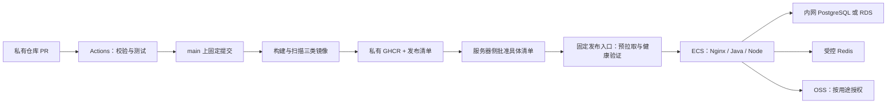

# GitHub 与阿里云 CI/CD 方案及预算（2026-10-13）

状态：供选择的方案与示例，尚未实施、压测或获得采购批准。本文不启用 GitHub 工作流、不购买资源、不部署、不迁移数据库，也不改变现有停机安排。示例中的脚本、生产配置和镜像仍需实施，不能直接视作可运行交付。

用户本轮最新背景：尽量使用 GitHub 免费仓库、Actions、GHCR；阿里云部署，优先 Docker；当前只有一台 2 核 4 GB 主机；预计总用户 500—800 人，匿名访问和同时在线未知。这取代此前准备文档“约 500 同时在线”的容量假设。CPU、内存不能直接从注册人数换算。

业务依据：ADR-011、ADR-029、《一期未完成事项》及原母版 D13.01/02/05/06、工程与正式交付章节。保留模块化单体、PG 业务权威、Redis 辅助、普通角色验收、真实外部事实与恢复核对边界。本文建议不改变业务规则。

## 1. 推荐结论

使用 **GitHub 私有仓库 + GitHub 托管 Linux Actions + 私有 GHCR + 阿里云 ECS Docker Compose**。生产机只运行指定版本镜像，不安装 Maven/前端构建工具、不执行通用 CI Runner。前端构建为静态文件，由 Nginx 服务；本项目 Node AI 网关是独立运行服务，仍须保留。

**优先把生产文件从 MinIO 改为 OSS；优先给数据库独立资源，再按实际负载升级应用。** 没有必要为了几百个注册用户先建设 Kubernetes、微服务集群或完整运维平台。121 个表 Maven 模块不意味着部署 121 个容器，主要是一个 Java 应用、一个 Node 网关、一个 Nginx 前端。

预算有限时：新增 4C8G 应用 ECS，原 2C4G 改为 PG + Redis 数据节点，文件使用 OSS。两机须能通过受控内网连接；若已有主机是轻量实例，先核对网络产品兼容，不能假定能直接加入同一 VPC。愿意支付数据库运维费用时：原主机跑应用与 Redis，PG 改用 RDS；应用压力明显再升级 4C8G。

现有 2C4G 全部自建可以短期验证功能，但不作为正式公开服务的默认方案；正式容量必须在隔离环境测出。Swap 可用于应急缓冲，不能充当额外物理内存或容量承诺。

## 2. GitHub 免费能力和限制

以下依据 2026-10-13 查看的官方文档，未读取实际账号额度或套餐。

| 能力 | 当前官方口径 | 本项目使用方法 |
| --- | --- | --- |
| 仓库 | Free 支持私有仓库，部分治理能力受套餐限制 | 源码及业务配置模板私有；真实凭据、数据库、材料不入库 |
| Actions | Free 私有仓库：每月 2,000 分钟、500 MB artifacts；缓存默认每仓库 10 GB | 使用标准 Linux runner；任务使用Linux原生Bash及构建工具；超额停止与账单预算以账号配置核对 |
| GHCR | Container registry 镜像存储和带宽目前免费，政策可能调整 | 三个私有业务镜像；按 digest 部署；它不应被误算成普通 Packages 的 500 MB/1 GB 配额 |
| 私有仓库保护分支 | GitHub Free 不提供与付费私有仓库相同的保护分支能力 | 严格减少写入者，日常走 PR；要求强制合并门禁时再升级套餐，不能宣称流程约定是技术强制 |
| 私有生产环境审批 | Free 私有仓库不能依赖 Environment secrets/保护规则；Free/Pro/Team 的 required reviewers 只在公开仓库可用 | 首期在服务器一侧批准固定发布清单；不为审批而公开业务仓库 |
| 安全工具 | 各功能受仓库可见性与套餐限制 | 依赖更新、开源凭据扫描、镜像扫描可接入 CI；不承诺所有私有 CodeQL/安全服务免费 |

官方依据：[Actions 计费](https://docs.github.com/en/billing/concepts/product-billing/github-actions)、[Packages 与 GHCR 计费](https://docs.github.com/en/billing/concepts/product-billing/github-packages)、[Environment 限制](https://docs.github.com/en/actions/reference/workflows-and-actions/deployments-and-environments)、[保护分支](https://docs.github.com/en/repositories/configuring-branches-and-merges-in-your-repository/managing-protected-branches/about-protected-branches)。

Actions 估算举例：每月 60 次 PR 校验 × 12 分钟 + 20 次正式构建 × 25 分钟 = **1,220 runner 分钟**，免费额度内留约 780 分钟余量。12/25 分钟是计划假设，本仓库首次全量构建可能更久；每个并行 job 的耗时相加，不能用整条流水线墙钟时间代替计费时间。100 次 PR × 15 分钟 + 30 次发布 × 25 分钟 = 2,250 分钟，已经超出。

优化：Maven/pnpm 缓存依赖；取消被新提交替代的 PR 检查；文档改动只做必要检查；正式发版和数据库迁移不能被新任务中途取消。只上传脱敏报告和小型发布清单，保留 3—7 天，不把几百 MB 的 JAR/镜像长期放 artifacts。控制缓存不超过免费上限，设置费用预算和额度通知。

## 3. 运行组件与资源估算

下表是规划范围，单位为 GiB，未测量实际 RSS；镜像版本、请求、文件解析和缓存会影响数值。Docker 共享宿主机内核，不是每个容器各安装一个完整系统，但也不会消除应用本身的内存。

| 组件 | 估算运行内存 | 提醒 |
| --- | ---: | --- |
| Linux、Docker、必要代理及系统余量 | 0.6—1.0 | 还需留磁盘页缓存与峰值空间 |
| Java 17 应用 | 1.5—2.5 | 堆之外还有 Metaspace、线程、直接内存；PDF/图片解析可出现更高峰值 |
| Node AI 网关 | 0.2—0.6 | 模型在外部调用，本方案不在 ECS 跑本地大模型；正文/图片及并发仍占内存 |
| Nginx + 前端静态文件 | 0.05—0.15 | 前端不跑 Vite 开发服务器；此处没有第二个前端 Node 进程 |
| PostgreSQL | 0.6—1.5 | 排序、连接、WAL、备份与数据库页缓存还会增长 |
| Redis | 0.15—0.4 | AOF 重写等操作需要峰值空间，不能只按数据量计容器上限 |
| 单机 MinIO | 0.3—0.8 或更高 | 受对象数、请求与版本影响；同盘备份、上传、PG 会争用 I/O |
| 合计 | 约 3.4—7.0 | 含部分组件余量，尚不能保证覆盖所有同时峰值 |

所以 4 GB 不是完全启动不了，而是很难保留足够峰值余量。Maven、pnpm 构建、镜像构建如果也放在此机，更容易 OOM；应全部在 Actions 完成。

| 档位 | 部署方式 | 使用条件 |
| --- | --- | --- |
| A：现有资源过渡 | 2C4G：Java + Node + Nginx + PG + Redis；文件用 OSS | 受控内部试运行，限制 AI/材料并发，允许维护停机；仅在实测总内存和峰值有余量后启用 |
| B：低预算单机 | 升级 4C8G：应用 + PG + Redis；OSS | 较低维护成本，仍是同机单点和 I/O 竞争；原机升级价格需询价 |
| C：复用现有主机，推荐节约档 | 新增 4C8G：应用；原 2C4G：PG + Redis；OSS | 分离数据与应用资源，便于后续替换 RDS；两机都须备份、监控、补丁和受控网络 |
| D：减少数据库运维，推荐托管档 | 2C4G 或 4C8G 应用 + 本机 Redis；RDS PG 2C4G 起评估；OSS | 用预算换备份/恢复和数据库维护能力；RDS 基础单实例与高可用实例要分别比较 |
| E：赛事不停机增强 | 两台应用 + 负载均衡 + RDS 高可用 + 受控共享 Redis + OSS/CDN | 发生明确可用性要求再做；需要验证任务、定时清理、共享锁和连接恢复，不能直接复制容器宣称双活 |

没有哪一档仅凭配置就保证 800 人同时操作。匿名流量、机器人和首次静态加载可能先耗尽带宽。

4C8G 单机 B 档可从以下资源预算起测：Java 容器 2.5 GiB、堆上限约 1.25—1.5 GiB；Node 0.5 GiB、JS 堆约 0.25 GiB；PG 1.5 GiB；Redis 0.5 GiB（实际 maxmemory 从 128—256 MiB 起测）；Nginx 0.25 GiB；系统 0.75 GiB。合计约 6 GiB，余下约 2 GiB 支撑峰值与页缓存。这些不是正式生产参数。

PG 连接池先保持每个应用 10—15 个连接候选，两个应用合计计数，给迁移/备份/运维保留连接；不要设置 800 个连接。小规格数据库的 `work_mem` 不能盲目加大，它可被每连接的多个排序/哈希操作使用。先看慢查询、锁等待、连接池等待、I/O 再调。

Redis 存放会话、限频和锁时，优先评估 `noeviction`，避免随意驱逐关键控制键；达到上限须告警并让依赖操作明确失败，不能绕过锁/限频放行。所有非必要键需 TTL。可用 AOF 提升重启连续性，但持久化、重新登录和锁恢复仍须验证；资金、名额和结果始终以 PG 事务/约束为权威。

## 4. 预算示例

以下是**本方案预留的人民币预算区间，不是阿里云官方报价或已核验成交价**。假设中国内地常规地域、Linux x86-64、初期数据库几十 GB、对象 20—50 GB、按实际用量支付文件下行；折扣、实例族、云盘、带宽和续费会改变价格。当前官方产品页面包含动态询价，不能把社区活动价当实际订单。

| 项目 | 月预算预留 | 计费核对 |
| --- | ---: | --- |
| 新增/升级 4C8G 应用 ECS | 200—500 元 | 区间暂含普通小规模系统盘和低档带宽；大带宽、数据盘、升级差价另报价，不应重复计入 |
| 原 2C4G 主机 | 已付期间新增为 0 | 续费另看已有订单；不能把既有成本当长期免费 |
| 数据盘、快照及备份额外空间 | 20—100 元 | 自建 PG 建议独立数据盘、与系统盘分开，保持可用空间；同机不同盘不构成异机容灾 |
| RDS PostgreSQL 候选规格 | 200—700 元 | 预留范围；按 2C4G、基础/高可用、存储、备份保留和续费分别询价，高可用可能超出 |
| OSS + 初期备份 + 小流量文件下行 | 10—80 元 | 超过预设文件流量、版本保留大量对象时增计；图片下行可能比存储更贵 |
| GitHub Free + GHCR | 目标 0 元 | 必须在 Actions/artifact/cache 免费额度内，GHCR 按当前政策 |
| CDN、SLS 等选配 | 0—100 元起 | 初期可按需开启；WAF、商业监控/证书等不默认计入 |

方案粗算：A 档新增约 **10—100 元/月**，另付现有主机续费；B 档常规资源总预算约 **230—680 元/月**，替换/升级原机的净增不同；C 档新增约 **230—680 元/月**，加原机续费；D 档保留原机做应用时新增约 **210—880 元/月**，应用同时新增 4C8G 时约 **410—1,380 元/月**。以上不含可选 CDN/SLS、短信、人机验证、模型 API、域名、人工运维、跨地域容灾或更高带宽。

若整体每月现金预算只能接受约 100 元，先做 A 档受限试运行和 OSS 备份；若能接受数百元，先比较 C/D 档真实订单，避免只为了购买更大应用机而继续把重要数据库挤在一起。

询价必须记录：地域、实例族、CPU/内存、系统盘/数据盘容量与 IOPS、固定带宽或流量、预付年限、首购与续费、PG 版本/架构、备份保留。不能把活动限定的 199 元/年视为所有 2C4G 的价格，更不能从该价格推算 4C8G。核价入口：[阿里云配置报价](https://www.aliyun.com/price)、[RDS PostgreSQL](https://www.aliyun.com/product/rds/postgresql)、[OSS](https://www.aliyun.com/product/oss)。

## 5. 目标部署与发布流程



每个正式版本包含：提交 SHA、CI run ID、三个镜像 digest、镜像 SBOM/扫描结论、迁移文件 checksum 与目标版本、配置版本及上一版回退清单。发布清单不含凭据。不要用 `latest` 作生产依据；前端/Java/网关按一个发布包核对兼容。

CI：PR 不持有生产机、生产库、OSS 写入或模型/短信生产凭据；运行类型检查、真正启用的 Java/Node/前端单测、迁移静态检查、模型生成物一致性、凭据扫描。隔离集成测试只接临时 PG/Redis/文件资源及合成数据。通用模型调用与真实短信验收单列，不能让每个 PR 产生真实费用或发送消息。

正式构建：可信 main 固定提交执行校验并构建镜像，复制已通过测试的最终 JAR/前端产物；推送 GHCR；记录 digest。预发布与生产使用同一组镜像，不在部署节点重新编译。不把任意外部 PR artifacts 交给拥有 secrets 的 `workflow_run` 直接执行；避免 `pull_request_target` 检出不可信提交后运行其脚本。

首期持续交付：构建自动完成，生产部署由负责人选择已验收的发布清单，在Actions手动选择成功构建清单，通过严格主机密钥校验的SSH执行Linux Bash发布入口。私有包使用短效只读任务认证，服务器运行凭据单独保管；按用户最新决定，SSH登录密码在GitHub Actions Secrets中受控配置，主机公钥预先通过可信渠道确认。

需要自动部署时，可加**独立、固定的拉取部署服务**：周期检查经授权批准的期望发布清单，只处理固定仓库、镜像和 Compose 文件，不执行远端任意代码，不自动追踪 `latest` 或未经批准的新 tag。服务的清单批准通道、签名校验、身份与审计须实现。它不是 GitHub 自托管通用 Runner；不能把 Actions 上的仓库写权限直接当成生产发布批准。后续也可评估阿里云云助手/受限 SSH + OIDC，但需明确受支持的身份联邦配置和最小权限，不假定购买 ECS 即自动具备。

GHCR 在境外，**本轮没有从阿里云实测登录/拉取速度**。正式切换前预拉取全部镜像，失败就保留旧服务；保存当前和上一版镜像，避免回退依赖跨境网络。先实测白天/晚间拉取，再决定是否增加阿里云镜像仓库副本；副本也必须按实际 digest 核验，产品可用性、费用与地域单独核对。

## 6. 发布、迁移和回退

低规格单机默认接受短维护窗口。Compose 替换服务不天然是滚动发布，`restart` 也不天然是自动故障切换；2C4G 不建议同时启动两套完整 Java 服务做蓝绿。4C8G 双版本也须先核算峰值。

固定发布入口的顺序：

1. 核对批准的清单、提交来源/CI 结果、镜像 digest、配置版本、磁盘与内存、当前版本及部署锁；未知字段、任意路径、任意镜像仓库一律拒绝。
2. 在旧版还服务时拉取全部镜像，完成扫描/签名策略核对，保存上一版；pull 失败不停止旧服务。
3. 核对最近一次有效备份及恢复证据；需迁移时短时关闭业务写入口，等待正在办理的事务和任务收尾，确认执行边界。
4. 使用独立迁移角色及一次性迁移任务，先核对已应用 checksum，再单次执行新增迁移与记录。应用账号不得承担常规 DDL 超级权限。
5. 只更新本次发布的应用服务，数据服务单独维护；数据库不能随着每次应用发布重新创建、清空或升级大版本。
6. 等待真正的就绪状态，验证登录、公开页、PG/Redis/OSS、SSE 及普通角色只读路径；生产检查不能创建虚假到账或正式赛果。必要写流程在隔离预发布执行。
7. 通过后恢复入口、记录三类实际镜像 digest 与迁移版本；观察至少 10—15 分钟，失败按兼容策略处理。

数据库采用 **先扩展、再迁移、后删除**：先新增可兼容字段/表，允许上一版正常读写；回填与索引变更按锁影响评估，破坏性删除在确认不再回退后独立发布。不能承诺所有 SQL 都可单事务执行，例如 `CREATE INDEX CONCURRENTLY` 需要另行受控策略。

生产迁移沿ADR-049，由Spring Boot启动早期的Flyway专用所有者连接执行，业务连接保持受限账号。首次目标库需单独准备框架表、应用角色/默认授权和框架版本0标记，再完整执行业务基线；不能把旧业务库当新库重放。既有正式Flyway库仅追加版本，不改已应用脚本。RDS连接与权限须按真实云配置核对。

**应用回退**：只切回上一组镜像/兼容配置，数据库通常保持前向。若迁移破坏兼容，停止自动回退，由负责人选择前向修复或受控恢复。**恢复数据库**：是灾难恢复，会丢失备份点后的数据；已有真实收退款、已发短信及现场结果不会随库回退。恢复必须暂停业务、核对外部事实，不能每次发布失败就覆盖生产库。

## 7. 数据与文件保护

PG 自建：数据存持久数据盘，严格控制开放路径；业务应用、迁移、备份角色分开，备份角色赋予实际所需读权限。每天做逻辑备份、每次有风险迁移前追加备份，将校验后的备份加密上传独立 OSS 桶/前缀；备份执行在云端，不把生产库送 GitHub Actions。备份机角色尽量仅新增备份对象，保留/删除与恢复权限由独立受控角色管理，减少误删和勒索扩散。

每日 dump 只能提供接近 24 小时的数据损失窗口，且还取决于最近成功备份；它不是任意时间点恢复。如果收退款/报名不能接受这种损失，正式目标应升级到 RDS 的数据/日志备份和时间点恢复，或自建基础备份 + 连续 WAL 归档。RDS 实际保留、恢复粒度、目标点和故障切换须按选购架构演练，不能只写“有 RDS 所以零丢失”。官方原理：[PG SQL Dump](https://www.postgresql.org/docs/17/backup-dump.html)、[PG WAL/PITR](https://www.postgresql.org/docs/17/continuous-archiving.html)。

目标候选：受控内部试运行允许 RPO ≤24 小时、RTO ≤4 小时；公开办理真实报名/资金时评估 RPO ≤15 分钟、RTO ≤1—2 小时。RPO 是可接受数据损失，RTO 是恢复时间；这是待运营确认和演练证实的目标，不是本文已实现指标。

备份保留候选：每日 14—30 份；更长时间按资料生命周期/运营要求决定，不默认永久。对象文件与 DB 引用、必要配置、JWT/phone-pepper 等关键材料配套恢复。密钥单独受控备份，不能只存在故障主机，也不与数据备份放同一可公开目录。

OSS 按用途配置：敏感身份材料、收款码、付款凭证、私人证明保持私有，先业务授权再短时下载；公开宣传图/静态资源可按明确公开范围独立桶或前缀。不能通过将整个桶公开解决图片展示。生产使用独立桶/凭据和同地域内网 endpoint；浏览器下载仍有外网/请求费用。上传、下载、签名、删除、对象键及历史引用必须验证，S3 兼容不等于所有特性完全相同。[OSS S3 兼容范围](https://help.aliyun.com/en/oss/developer-reference/compatibility-with-amazon-s3)、[OSS 流量费用](https://help.aliyun.com/zh/oss/traffic-fees/)。

版本控制/备份副本用于防误删，生命周期必须与最旧可恢复数据库点匹配：例如数据库保留 30 天，而旧附件第 7 天被物理删除，则恢复旧库会得到失效引用。保留可恢复对象版本或备份副本，恢复后重新应用已批准的注销、删除及访问限制。版本控制还会增加存储费，不能只按当前文件体积计费。

自建 MinIO 若暂时保留：独立持久数据目录、非默认凭据、私有 API/控制台、应用专用最小桶权限及异机对象备份；单节点单盘无高可用，同一 ECS 上的 PG/MinIO/备份一起损坏仍可能全丢。当前 Compose 使用第三方 `pgsty/minio`，生产应核对维护来源、许可证、漏洞与固定 digest；本方案不沿用默认账号/密码。

每月至少一次隔离恢复，关键发版或备份策略变更后补演练：不仅库可启动，还要验证普通账号、组织隔离、报名数量、收退款记录/净额、名额、成绩、文件引用与实际文件、能力渠道、密钥可用和恢复后的撤销限制。记录真实耗时、恢复点及缺口。

## 8. 安全边界

- 公网只开放业务 80/443；SSH/运维走可信来源或受控管理通道。PG 5432、Redis 6379、Java 8080、网关 8091、MinIO 9000/9001 不对公网发布。安全组、宿主防火墙和实际端口都验证，不能只认为容器 `expose` 等于防火墙。
- HTTPS、证书自动续期及到期告警；Nginx history 回退、`/prod-api` 路径映射、上传上限、SSE 不缓冲和超时按实测配置。公开静态缓存与私有/API 缓存分别配置。默认不公开 monitor/SnailJob/Actuator 信息或管理接口。
- 运行镜像使用固定基础版本/digest、非 root、有限可写目录、CPU/内存/PID 上限、默认隔离与必要最少权限；应用不挂 Docker socket，不开启 privileged，不使用 host 网络。宿主 Docker 控制权接近 root，发布服务必须视作高权限维护组件。[Docker 安全](https://docs.docker.com/engine/security/)。
- Actions 默认 `contents: read`；只有可信镜像发布 job 授予 `packages: write`。PR 不接触生产 secrets；Actions 固定官方来源已核对的完整 commit SHA；PR 标题等不可信字段不能直接拼脚本。SBOM/依赖/镜像扫描覆盖各运行组件，漏洞修复通过重新构建发布完成。[Actions 安全](https://docs.github.com/en/actions/reference/security/secure-use)。
- Actions 推送用短期 `GITHUB_TOKEN`；生产拉私有 GHCR 用只具所需 `read:packages` 的 classic PAT，账户还须有包读取权及必要组织 SSO 授权。禁止复制写包/删包/广泛 repo 权限到主机。限制 token 有效期，轮换并验证拉取。[GHCR 身份认证](https://docs.github.com/en/packages/working-with-a-github-packages-registry/working-with-the-container-registry)。
- DB、Redis、OSS、短信、模型密钥保存在主机受控配置/密钥服务，不写入 Dockerfile ARG/ENV、镜像层、源码、发布清单或日志。普通 `.env` 和 Compose secrets 都不等于自动加密密钥库；环境变量会被有 Docker 控制权的人读取。现有客户端若不支持文件/临时凭据，先用受控挂载配置并安排适配。
- 云端备份工具可优先用 ECS RAM 角色 + STS 临时凭据；当前业务存储客户端是否支持临时凭据/自动刷新须验证，不能假定已有配置可无缝使用。实例元数据采用加固方式，并阻止不需要该权限的容器/SSRF 访问。[实例 RAM 角色](https://help.aliyun.com/zh/ecs/user-guide/attach-an-instance-ram-role-to-an-ecs-instance)。
- 按账号/IP/接口设限，公开浏览可缓存公开赛事摘要；报名仍服务端事务校验；AI、短信、上传、登录使用不同限制。AI 初始全局并发 1—2 个、设置总预算/单次上限和有界等待，材料大小及渲染页数受控；这是待实现/调优候选，不宣称当前已经生效。匿名 AI 费用尤其单独监测。
- 日志不保存完整请求体、材料正文、验证码、密码或可复用令牌。现有 SSE 查询参数携带令牌，访问日志应记录去查询的路径而非完整 URI，并核对所有代理/云日志来源；仅隐藏页面令牌不足以避免日志泄露。
- 容器日志限制大小/轮转防止占满盘；轮转日志只是热日志，安全日志长期保留按已确定的上线要求另做脱敏归档/权限保护。本项目此前提出六个月归档待落实，不能把现有 1/60 天日志改写成已经满足。

## 9. 当前工程必须补的适配

| 静态核对现状 | 上线前工作 |
| --- | --- |
| Java 17 / RuoYi 5.6.2，前端 `pnpm@11.19.0`、Vite 构建；AI 网关独立 | CI 核对 pnpm 与所选受支持 Node LTS 的兼容，锁定版本；前端使用 `build:prod`，不照搬本机绝对工具路径 |
| `backend/pom.xml` 默认 `skipTests=true`，Surefire 根据 `${test.groups}` 过滤 | CI 显式开启测试，明确单测与隔离集成组，核对报告测试数/失败/异常跳过；仅 `mvn package` 成功不能当测试通过 |
| `application-prod.yml` 仍上游 MySQL，local 回环地址依赖本机 | 新生产 profile 指定 PG、Redis、网关、JWT、存储、加密策略、clientid/回调及关闭的扩展；容器内 localhost 不能指向另一个容器 |
| `ai-gateway/server.mjs` 固定 `server.listen(port, '127.0.0.1')` | 支持显式监听地址，容器内监听 `0.0.0.0`，用 Docker 网络隔离外部访问；为网关增加独立健康/就绪端点 |
| 后端 local `server.address=127.0.0.1` | 生产容器绑定适合服务网络的地址，只由内部网络访问；外部不映射后端端口 |
| 上游后端 Dockerfile 含 Bash 入口、默认 root、ZGC、日志目录 | 新生产镜像用 Java exec 数组入口，不依赖 shell 展开，`JAVA_TOOL_OPTIONS` 注入非敏感 JVM 参数；低规格优先从 G1 起测，有限日志/临时目录，中文字体及 PDF/图像功能核验 |
| POI/PDFBox/ImageIO 处理 DOCX/XLSX/PDF/图片，Java 中实际解析 | 镜像包含正确字体/字体配置/所需图像依赖和可写临时空间；复杂文件内存单独压测，不能把 Node 堆限制当 Java 渲染峰值保护 |
| Compose 目前是本机 PG/Redis/MinIO 基础设施，含本机初始化与凭据目录 | 新生产 Compose 与首次初始化流程；现有 root Compose 不直接用于生产，分开应用与数据生命周期 |
| 本机测试/发布脚本依赖 Windows 路径、`.local` 运行回执及固定端口 | 在 `scripts/` 增加 Linux/Actions 原生 Bash/Python 入口与严格返回码处理，保留原脚本与本机证据 |
| 现有迁移 V001—V041 与 checksum 历史 | 从干净基线/已有库两个路径验证，新增迁移不改旧文件；生产数据库版本首先与当前 PG17 基线匹配，不顺带升级大版本 |
| 能力 registry/渠道/授权在 DB，phone-pepper 与资料摘要/加密相关 | 注册经过验收的生产能力，未经验证写渠道保持关闭；密钥与历史数据迁移配套，不能随手更换 pepper 后声称迁移成功 |

相关已有问题与业务接入仍参照[阿里云部署准备](阿里云部署与备案准备-20261013.md)、[一期未完成事项](一期未完成事项.md)。本轮没有修复上述代码问题，也不重标既有本机测试为云端验证。

## 10. Actions 配置（已编写，远端待验证）

实际文件为 `.github/workflows/ci-images.yml` 和 `.github/workflows/deploy-ecs.yml`，使用已核对的官方Action完整commit SHA。PR只读检查；main构建测试后推三个GHCR镜像；手动选择成功构建run ID，通过SSH按digest更新ECS应用。

Linux runner使用Bash与Python3处理清单、来源校验和SSH传输；ECS使用原生 `scripts/deploy-ecs.sh`、Bash/coreutils/flock及Docker Compose，不需要CI端Python。数据服务独立，发布不删卷或重建数据库；后端启动Flyway沿ADR-049。

详细Secrets、一次准备、备份确认、权限、实例架构及未执行边界见[Actions与ECS配置说明](GitHub-Actions与ECS发布配置-20261013.md)。原拟新增的Test-Ci／Build-CiRelease示例由实际入口替代，不能把本地语法检查当作GHCR/ECS运行通过。

## 11. 应用 Compose 示例片段（C 档 4C8G 应用主机）

这是目标结构片段：使用 OSS、PG/Redis 位于另一受控节点，未包含 TLS 证书/完整 Nginx 配置/正式健康检查/主机发布入口。应用 profile、网关监听/健康端点、非 root 镜像和日志适配均是前置工作，当前源码不能直接按此运行。

资源名称沿用仓库要求的 `aisports-dev-*` 前缀；生产与开发必须是不同主机/资源，不能在同一 Docker daemon 复用同名项目。环境由主机与配置区分；未来改生产命名应统一修改约定，不能本轮擅自操作其他资源。

```yaml
name: aisports-dev

x-app: &app
  restart: unless-stopped
  init: true
  read_only: true
  cap_drop: [ALL]
  security_opt: [no-new-privileges:true]
  pids_limit: 256
  logging:
    driver: local
    options:
      max-size: '10m'
      max-file: '3'

services:
  web:
    <<: *app
    image: ${WEB_IMAGE:?要求完整镜像名及sha256 digest}
    user: '101:101' # 要求自建 Nginx 镜像对应 UID，写目录授权一致
    mem_limit: 256m
    cpus: 0.5
    ports: ['80:8080', '443:8443']
    tmpfs: ['/tmp:rw,noexec,nosuid,size=64m,uid=101,gid=101']
    # 自建镜像须用 /tmp 保存运行文件，证书通过受控只读挂载提供。
    networks: [app]

  java:
    <<: *app
    image: ${JAVA_IMAGE:?要求完整镜像名及sha256 digest}
    user: '10001:10001'
    mem_limit: 3g
    cpus: 2.5
    stop_grace_period: 60s
    environment:
      JAVA_TOOL_OPTIONS: '-Xms512m -Xmx1536m -XX:+UseG1GC -Djava.awt.headless=true'
      SPRING_PROFILES_ACTIVE: production
      SPRING_CONFIG_ADDITIONAL_LOCATION: file:/run/config/
    volumes:
      - /opt/aisports/config/java:/run/config:ro
    tmpfs: ['/tmp:rw,noexec,nosuid,size=128m,uid=10001,gid=10001']
    # production profile 当前待新增；应用日志改 stdout，或另设有限持久目录。
    networks: [app]

  ai-gateway:
    <<: *app
    image: ${GATEWAY_IMAGE:?要求完整镜像名及sha256 digest}
    user: '10001:10001'
    mem_limit: 768m
    cpus: 1.0
    environment:
      NODE_OPTIONS: '--max-old-space-size=384'
      AI_GATEWAY_PORT: '8091'
      AI_GATEWAY_HOST: '0.0.0.0' # 目标参数，当前源码尚不支持
    env_file:
      - /opt/aisports/secrets/gateway.env
    tmpfs: ['/tmp:rw,noexec,nosuid,size=64m,uid=10001,gid=10001']
    networks: [app]

networks:
  app:
    name: aisports-dev-app-network
    # 不设置 internal:true：网关要请求外部模型，Java也需访问外部供应商。
```

生产发布脚本必须对三项 IMAGE 值实行仓库白名单及 `@sha256:64位hex` 验证，Compose 的必填表达式本身不能保证 digest。所有秘密文件由受控角色写入、权限与容器 UID 匹配；主机运维账户与 Docker 控制权严格限制。PG/Redis 节点只接受实际应用来源，Redis 持久数据与 PG data/WAL 单独规划。

`cpus` 是各容器上限，例中合计 4 核，不保证每个容器随时同时获得上限；`mem_limit` 也只是限制而非预留保障。此片段只适用于 4C8G 应用机，不可照抄至 2C4G 或与 PG/MinIO 同机后还声称内存足够。

## 12. 匿名流量、压测与扩容依据

在线人数、请求速率、同时执行请求数与连接数分别统计。例：100 活跃用户平均每 10 秒 2 个 API 请求，约 20 RPS；800 活跃用户同样操作约 160 RPS；若平均响应 0.2 秒，平均约 32 个请求同时在途（160 × 0.2），不是 800 个数据库连接。若每人一条 SSE，另有 800 长连接，代理还要计算上游连接和文件句柄。

匿名流量无法预估就用可观察的压力阶梯和边界限制。先 20、50、100 活跃用户持续，再 200、500、800 会话/长连接；公开页从 10、30、50、100、200 RPS 分级测试。增加 50/100 个同时报名抢最后名额、重复请求、跨组织拒绝、资金幂等、重启恢复等场景。测试在隔离环境、合成数据执行，不发真实短信、不记录虚假真实资金。

规划验收候选：普通读取 P95 ≤500 ms、业务提交 P95 ≤1 s、系统错误率 <1%、内存无 OOM、连接池无持续等待、名额/资金约束正确；模型与材料识别单列，不与普通 API 混算。售罄/限频/权限拒绝是预期业务结果，不计为服务器故障，但应单独统计。阈值要由实际页面与运营目标最终接受。

带宽示例：800 人每人首次下载压缩后 2 MB 静态资源，约 1.6 GB；5 Mbps 只有理论约 0.625 MB/s，单靠源站全部传完约 43 分钟（忽略开销）。这是总传输量估计，不是每人固定等待 43 分钟。静态包拆分、缓存与按需 CDN 可能比加 CPU 更有效，已登录数据、验证码、私人文件和资金 API 不公开缓存。

扩容候选触发：连续 10—15 分钟 CPU >70%、内存 >80% 或持续 Swap、PG/磁盘等待上升、连接池排队、P95 超目标、带宽持续 >70%，以及任何 OOM/备份失败。一次异常先定位；重复容量瓶颈再升级。磁盘可用不足 20% 先清理安全可删日志/旧镜像并补容量，不能清理数据库或未核对引用对象。指标是建议门槛，实际告警尚未配置。

扩展顺序：公开静态缓存/限频 → 观察慢 SQL/索引和 I/O → 应用 4C8G/数据分离 → RDS 或数据库升配 → AI 网关/材料任务隔离 → 确有可用性要求再第二应用/负载均衡。重复副本前先验证定时任务只执行一次、业务锁/约束、运行状态共享、SSE 重连和通知投递。

## 13. 落地顺序与尚缺的信息

1. 核对已有 ECS 的地域、实例族、Linux/Windows、公网带宽/计费、磁盘与 VPC，比较 C/D 档实价与预算。本文暂以 Linux x86-64 + Bash + Docker Compose 为目标。
2. 先实现容器监听/profile、镜像、CI 严格校验与 GHCR 清单，验证在阿里云完整预拉取；保留原本机脚本与证据。
3. 建生产独立凭据/桶/数据库和首次初始化方案，配套异机备份及一次恢复；未验收的 Agent 写渠道继续关闭。
4. 实现固定发布入口、部署锁、维护模式/任务排空、迁移兼容和回退，隔离预发布做普通角色与关键并发验收。
5. 负载分级实测、限频与预算告警、证书/日志/磁盘/备份监测，落实维护与资金/通知/恢复责任，再决定是否扩容与公开。

尚需补充但不阻止方案评审：已有服务器完整规格与带宽、可接受月预算、是否允许赛事维护窗口、真实数据是否要迁移、期望 RPO/RTO、每月图片/文件与 AI 用量、GitHub 仓库归属与套餐。不要在答复中提供真实凭据。

本轮验证仅为静态代码/文档与官方资料核对、方案一致性检查；未运行编译、接口、Docker、数据库、压测、备份恢复或云端部署，不将本机历史测试结论当成这些工作已完成。
