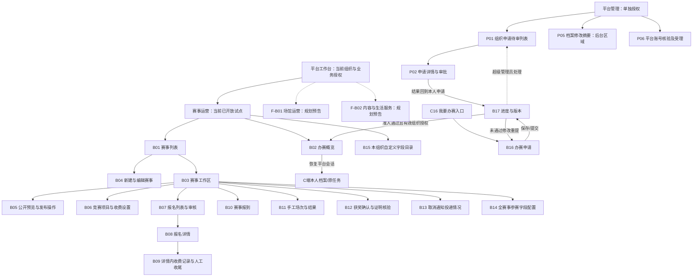

# B端 Page Map

版本：V0.5。日期：2026-10-07。状态：最终业务目标已同步，新增能力未实现/验收；布局仍为建议。依据 [ADR-011](../03-architecture/ADR-011-一期业务收口与交付边界.md) 及[UI 文档入口](README.md)。

## 1. 使用者与导航建议

B 端包含准入前的办赛服务和准入后的承办方工作台。B16/B17 使用平台账号，只能管理本人申请；工作台使用组织管理会话，只有本组织当前有效授权人员可操作。办赛动作沿用 organize，资金动作沿用 payment；初始负责人目前同时拥有两项，不代表权限永远合并。平台超级管理员处理组织申请，不代替承办方报名审核、收款或录分。

平台工作台区分业务空间：当前赛事运营，后续场馆运营、内容与生活服务仅规划预告，权限不自动继承。详见[平台级 UI 信息架构](平台级UI信息架构.md)。在当前赛事运营空间，一级导航保留「运营概览」「赛事」。选定赛事后进入赛事工作区，按「概览与发布」「竞赛项目」「报名名单」「报到」「场次与结果」「获奖」切换，持续显示赛事名称、组织和状态，减少不同页面反复选择赛事。工作区、详情与标签页是本轮信息架构建议，不要求新建每个标签的独立路由。

平台管理作为独立授权分区，在本文件用 P 编号，不能当作承办方的子菜单。当前框架系统管理能力继续按原权限存在，页面地图仅描述体育业务相关部分，不重做所有若依管理页面。

## 2. 页面层级图

B09 已确认集中 B08 的收费区域，B14 全赛事选用本组织 B15 字段；不要求独立路由。P04 旧平台目录方案停用并保留编号供历史追踪。P05 后台摘要及 P06 平台核验/受理任务的承载形式待设计，不批准完整治理平台。

## 3. 承办方页面目录

现有路径依据菜单迁移与前端文件；迁移中的菜单路径不等于本轮已验证运行可达。表内文件路径相对仓库根。

| ID | 页面/承载建议 | 核心任务与权限 | 设计状态 | 代码现状与现有对应 |
| --- | --- | --- | --- | --- |
| B16 | 办赛申请，B 端平台账号页 | 本人填写组织名称/联系人/联系方式/说明；保存缺项草稿、正式提交冻结；不要求参赛档案，不预建组织租户 | 确定 | 正式 /portal/organization?tab=apply；平台身份使用 BusinessFrame，草稿/提交/附件及拒绝重提沿真实 API |
| B17 | 审核进度与记录，含只读版本详情 | 本人查看待审/未通过理由/通过结果，拒绝重提与版本快照；有效授权后进入 B02 | 确定 | 正式 /portal/organization?tab=status；进度、只读版本抽屉及授权进入组织；结果由平台审核接口产生 |
| B01 | 赛事列表，一级页面 | 本组织赛事按发布/举办/时间阶段查看，进入工作区、新建，或从资料创建草稿；organize | 确定 | /org-desk/events；sports/event/index.vue。另有 /org-desk/events/from-document 上传资料、对照原文并确认草稿 |
| B02 | 赛事运营概览，一级页面 | 明确当前组织、可用权限、业务入口和待办；返回 C 端 | 确定 | /org-desk/home；sports/organization/desk.vue，实际赛事计数/列表，非跨组织大屏 |
| B03 | 赛事工作区，详情容器建议 | 保持选定赛事上下文，汇集状态、项目、报名、资金与执行入口 | 确定 | /org-desk/workspace/:eventId；sports/workspace/index.vue，九个任务标签、上下文及读失败/授权拒绝 |
| B04 | 新建/编辑赛事，页面或抽屉 | 名称、时间、地点、项目说明、责任联系信息；organize | 确定 | event/index.vue 创建/编辑弹窗、真实材料上传及组织内图片回显，保留后端变更限制 |
| B05 | 公开预览、首次发布/恢复/下架/取消，工作区区域与确认窗 | 展示可公开内容和缺项原因，确认联系人公开，区分各动作；organize | 确定 | 工作区 overview/publication，私有管理预览及发布/恢复/下架/取消；草稿不经公开接口预览 |
| B06 | 竞赛项目及收费设置，工作区标签页 | 建单打/双打/团体单元、人数、整单容量，维护金额/方式/人工退改依据 | 确定 | 工作区 projects，review.vue 项目/整单收费/容量、收款码，复用现有接口；服务端状态继续复核 |
| B07 | 报名列表与整单审核，工作区标签页 | 看成员确认、冻结名单、审核与资金分别状态；通过/拒绝，organize | 确定 | 工作区 registrations，review.vue 全项目/单项目筛选与独立资格/声明/资金；开赛不新增审核通过 |
| B08 | 报名详情，详情页/抽屉建议 | 查整单、成员及提交版本、审核理由、费用依据和关联事实 | 确定 | review.vue 报名详情抽屉，当前提交版本/名单及办理，版本对比与更细材料查询仍需核对 |
| B09 | B08 内收费记录与人工收尾 | 实收/补款、退款及依据、冲正、更正；payment | 确定 | B08 内到账表单及真实资金明细查询，整笔退款/冲正/有原因结案；补款分次退款及更正契约仍待补齐，不恢复完整财务菜单 |
| B10 | 赛事报到，工作区标签页 | 已通过冻结名单一赛事一人一次；收费冲正欠款按无人报到/已有执行分支；organize | 确定 | 工作区 checkin，competition/index.vue 分任务展示，取消/结束隐藏新增报到，实际条件由服务器校验 |
| B11 | 手工场次与结果，工作区标签页及录入窗 | 选本项目有效报名对阵，存草稿、批量导入草稿、确认正式结果；organize | 确定 | 工作区 matches，手工建场次/草稿录分/导入/正式确认及只读历史，正式结果本期不可更改 |
| B12 | 获奖确认与证明核验，工作区区域 | 关联正式结果或承办方确认的排名依据，按冻结名单发私人证明；organize | 确定 | 工作区 awards，人工依据/授奖及名单显示，不自动发奖或标官方等级 |
| B13 | 取消通知投递情况，工作区区域 | 授权人员查看站内信/短信状态、已读、失败和受控重试 | 确定 | 工作区 notifications，event/index.vue 真实渠道/投递/失败/重试，真实短信仍未接通 |
| B14 | 全赛事字段配置，赛事工作区区域 | 从本组织目录选择必填/选填、顺序和说明，首个正式提交冻结 | 确定 | 工作区 fields，field/index.vue 赛事选用/必填/顺序/说明和首次提交锁定 |
| B15 | 本组织自定义字段目录，维护区域 | 组织维护自身字段文本/数字/日期/单选枚举及启停，不逐字段平台审批 | 确定 | /org-desk/catalog，field/index.vue 本组织目录新增/编辑/停用；删除及其他既有待办不自动关闭 |

F 系列预告不是一期管理菜单或新增授权；未来正式业务空间需独立用途授权。品牌和平台层不绑定羽毛球，具体赛事工作区仍显示真实项目及已开放能力。

B02 不承诺跨组织统计或母版运营大屏。展示数量时区分整单报名、自然人数、名额历史占用和当前有效执行；取消赛事排除有效统计但保留历史，不把全部金额合成未经定义的营收指标。

## 4. 平台管理页面目录

| ID | 页面/承载建议 | 核心任务与权限 | 设计状态 | 代码现状与现有对应 |
| --- | --- | --- | --- | --- |
| P01 | 组织申请待审列表，一级页面 | 超级管理员查看待审申请并进入详情 | 确定 | /organization-review 下菜单；plus-ui/src/views/sports/organization/review.vue；仅核对代码与迁移，未实测菜单 |
| P02 | 申请详情与审批，详情区域建议 | 超级管理员查看提交版本及已有授权可见附件，批准或写拒绝理由；新材料上传按最新文件边界后置 | 确定 | review.vue 已有局部详情/动作；审批事务建组织、租户及授权，不由 UI 分多次模拟开户 |
| P04 | 原平台字段字典方案，历史编号 | 字段维护职责转 B15 组织目录，平台保留技术/敏感度约束 | 停用方案 | 不新增通用 profile 扩展目录页面；不因此直接删除已有属性数据 |
| P05 | 本人档案修改轻量摘要，授权后台区域 | 按账号/档案查询修改者、时间、字段及结果 | 确定 | 第 9 节已确认仅后台轻量摘要，尚无实现；页面位置/授权需细化，不展示全套敏感前后值 |
| P06 | 平台账号核验及受理，授权后台区域 | 注销受理/硬约束检查、证据核验关联及误关联更正，平台反馈承接 | 确定 | 待开发，复用必要后台操作，不开完整治理系统；自助注销入口可暂不开放 |

P 编号预留空位/P04 停用编号不表示遗漏，也不表示新增菜单。配套角色、任务顺序和状态见[用户模型](用户模型.md)、[User Journey](User-Journey.md)及[页面状态矩阵](页面状态矩阵.md)。P05/P06 平台访问不能以 tenant ignore 代替授权；P01/P02 审批权限不分发给普通组织，B15 只能维护本组织目录。

## 5. 关键办理路径

| 路径 | 页面衔接 | 必须保留的业务边界 |
| --- | --- | --- |
| 入驻开户 | C16 → B16 → B17 ⇄ P01/P02 → B17 → B02 | 同一平台用户申请；批准前不建组织租户；批准表示办赛准入，不能标资质已认证 |
| 创建并发布 | B01 → B04 → B03/B06 → B05 | 草稿保存可缺项；发布与报名可用配置分别校验，无有效收费配置不开放该项目报名；联系信息需确认公开 |
| 公开价格 | B06 → B05 预览 → C02/C06 | 生效单元价格同源且按整单报价，人工退改依据在收费开放前明确；历史义务不随新价格改变 |
| 名单审核 | B03/B06 → B07 → B08 → 审核操作 | 收费通过必须实收足额；无需审核按免费/收费分支，首个正式提交锁定配置，开赛/取消不新增通过 |
| 人工资金 | B08 内 B09 → 返回 B08/B07 | 必要登记/汇总，原实际付款人、金额/时间需核实；少付待补、多付人工，退款/冲正留原依据 |
| 恢复公开 | B03 → B05 恢复 | 有真实发布历史、下架/正常、未结束未取消、组织仍准入且信息合法；包括开赛后恢复，不重开报名 |
| 取消与收尾 | B03/B05 → 历史概览 → B08/B09 → B13 | 停止新报名/审核通过/报到/建场次/录分及确认/新证明，保留历史；资金全人工、名额停用；通知失败不撤销取消 |
| 现场执行 | B03 → B10 → B11 | 报到按赛事去重；场次两侧来自项目已通过报名；已付款不自动报到，确认结果不可覆盖 |
| 人工获奖 | B03 → B12 → C13 | 不从胜负自动发奖；按冻结名单产生本人证明；关联正式结果或承办方确认排名依据并留操作者/时间，不宣称外部官方等级 |
| 字段维护 | B15 → B14 → C06/C09 → 正式报名快照 | 组织自有、全赛事统一、每人本人确认；使用后语义保护，配置变更重确认，完整链待实现 |
| 返回平台侧 | 顶栏切换 → C05/原平台任务 | 轻量顶栏一期必做，当前身份/组织及权限/消息上下文同步；标签页独立会话后置 |

B06 在图中位于赛事工作区，不意味着所有竞赛单元必须在赛事首次公开之前完成；已确认的是某单元收费报名开放前有合法生效配置及公开责任信息。避免在页面地图新增未经批准的发布前置。

## 6. 操作与状态呈现

| 区域 | 必须看见的状态/反馈 | 操作限制 |
| --- | --- | --- |
| 赛事列表/概览 | 草稿/公开/下架、正常/取消、北京时间阶段；加载、空、失败、无权 | 隐藏按钮不能代替服务端授权；取消终态与结束时间不相互伪造 |
| 编辑与发布 | 发布缺项、时间关系、联系确认、版本变化；首次发布与恢复区别 | 已有报名后不改重大承诺；已结束不能靠改时间恢复；取消不可恢复 |
| 项目与费用 | 玩法/人数/整单容量、有效收费配置、未配置、免费/收费与生效依据 | 未配置不显示免费；R12 失败路径需具体反馈和安全重试，避免重复项目 |
| 报名详情 | 成员确认、提交版本、审核状态、应付/声明/到账/退款分别显示 | 只能操作规则允许的原报名；历史不被当前成员/档案倒灌 |
| 收费记录 | 事实表单、异常、冲正、待人工处理/已退款/无需退款及依据 | 不把第一名选手/应付金额/点击时间默认为真实到账；不以取消点击产生退款事实 |
| 报到/录分 | 未报到/已报到、场次、结果草稿/正式、导入逐项拒绝原因 | 取消后只读历史；重试不能新增第二事实，结果确认前解释不可再改 |
| 获奖 | 冻结名单、称号、已有确认及来源 | 不生成公开证书链接，不把后台看到证明解释成全平台公开 |
| 平台审批 | 待审、审批中、冲突、成功/失败及拒绝理由 | 开户失败整笔回滚，UI 不自行假设通过后重试部分开户 |
| 通知区域 | 已提交/送达/失败/待确认、站内已读与短信回执分开 | 最小双渠道必做，未知发送先核对再重试；已读非退款，跨组织收件不放开后台读取 |

## 7. 仍需设计及落实的页面事项

1. B08/B09 采用详情内必要表单/记录，设计操作和错误反馈，不增加财务系统。
2. B15/B14 全赛事字段配置与本人确认/快照版本的接口和权限设计，不重新讨论项目级配置。
3. B12/C15 已确认本人正式赛果及授奖依据，落实展示/查询，不做自动排名。
4. B13/C14 最小双渠道必做，落实持久收件/已读、实际供应商条件、有限重试和待确认状态。
5. P06 核验/注销办理与平台受理，P05 轻量摘要；上线前实际责任/反馈/资料期限待落实，不增加完整治理页。

以上均回到原业务清单处理，不在本地图重新编号为缺陷。新增员工授权页、标签页独立组织会话、体育局门户、全套财务对账、自动编排、申诉改判、平台代收和商业运营大屏不进入本轮必交 Page Map。

## 8. 来源与代码核对入口

- [ADR-004](../03-architecture/ADR-004-组织与资质.md)、[ADR-005](../03-architecture/ADR-005-平台账号与租户主体.md)、[ADR-006](../03-architecture/ADR-006-赛事公开.md)、[ADR-007](../03-architecture/ADR-007-报名.md)、[ADR-009](../03-architecture/ADR-009-收费记账.md)、[ADR-010](../03-architecture/ADR-010-录分报到和证书.md)。
- [一期未完成事项](../01-development/一期未完成事项.md)第 9—39 节，最终规则以 [ADR-011](../03-architecture/ADR-011-一期业务收口与交付边界.md) 为准；[母版](../99-raw_materials/保定体育综合服务平台_全域业务母版_V1.0.md)B01–B04/B06/P01 按当前简化范围承接。
- [组织工作台菜单](../../database/migrations/V007__organization_application.sql)、[赛事菜单](../../database/migrations/V008__event_publication.sql)、[报名菜单](../../database/migrations/V009__registration_entry.sql)、[原财务菜单](../../database/migrations/V011__fee_accounting.sql)、[执行菜单](../../database/migrations/V013__competition_execution.sql)。
- [赛事管理页面](../../plus-ui/src/views/sports/event/index.vue)、[报名审核页面](../../plus-ui/src/views/sports/registration/review.vue)、[旧财务页面](../../plus-ui/src/views/sports/finance/index.vue)、[报到录分页面](../../plus-ui/src/views/sports/competition/index.vue)、[平台审批页面](../../plus-ui/src/views/sports/organization/review.vue)。

## 2026-10-07：申请人办赛服务与平台审核分工

B16/B17 不需要已准入组织会话；准入前只展示办赛申请与进度，不能显示可操作的组织赛事/资金菜单。一人一份申请，待审内容冻结，拒绝保存修改仍是未通过，再提交生成新版本；通过后组织/租户/授权在同一事务建立，页面不能拆成申请人自行开户步骤。

用户将“资质审核查看”作为申请人的必要流程，本轮采用现有的“平台办赛准入审核”命名。正式资质认证、固定证照清单、到期/补正仍未启用；准入标签不宣传为官方验真。P01/P02 沿 RuoYi 原生后台增加业务审核，页面编号与一期业务要求保留，仅本轮视觉原型暂不增加管理员审核页；不表示正式交付可以省略审核能力。

本轮已核对文档任务与 HTML 覆盖：定义保留不等于原型已画；逐项缺口及共享 B 端布局见 [UI 覆盖与一致性检查](UI覆盖与一致性检查.md)。

UI-R02/R08/R09 已落实到 HTML：概览待办进入对应任务集合，B08 定位资金或审核区域，工作区页/任务与资格筛选由合法路由恢复，嵌套弹窗先关闭。未开放空间位于导航末尾规划分组；不改变当前业务权限或正式页面实现状态。验证与截图见 [执行单](两端原型UI评审与改进执行单.md)。

## 2026-10-07：正式 B 端接入

最新代码现状以上表和[B端正式界面开发记录](B端正式界面开发记录.md)为准，原型局部不等于全部业务验收。同一个 plus-ui，B 端独立业务外观，超级管理员保留原生 RuoYi；21 项功能、17 项缺口及普通角色验收未由本轮关闭。

## 2026-10-08 正式页面走查调整

赛事列表以进入工作区为主要操作；工作区概览编辑基础信息，“报名设置”集中截止时间/审核方式/报名信息，“发布管理”单独办理，顶部常驻参赛者预览。预览共用 C 详情与卡片，可切换电脑/手机详情及首页卡片，内部只读已保存内容，不发布草稿。原 task=fields 深链保留。组织 Logo 留在 B 端，返回运动平台恢复平台会话，准入通过后 C 顶栏直达工作台。

待审核列表默认只看待审核；不足额通过置灰且说明。付款通知可选，不代表实际到账或资格通过；拒绝/撤回/取消后的真实资金按原款收尾。逐笔实收与实际退款更新，受控更正和真实验收独立保留。具体映射见 [交互执行记录](交互修改执行记录-20261008.md)，业务决定见 [ADR-013](../03-architecture/ADR-013-交互走查与资金事实补齐.md)。
