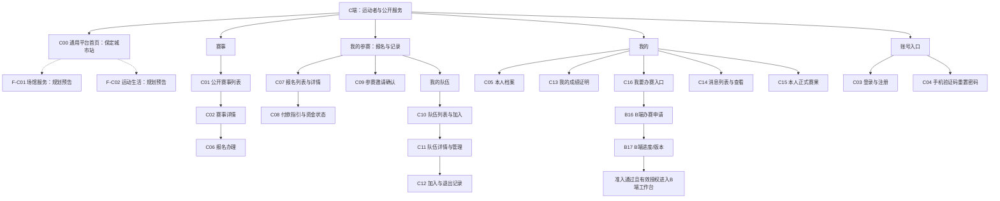

# C端 Page Map

版本：V0.7。日期：2026-10-07。状态：业务目标已同步，主要 C 端正式界面已改版，真实普通角色浏览器验收仍待完成。规则见 [ADR-011](../03-architecture/ADR-011-一期业务收口与交付边界.md) 及[UI 文档入口](README.md)。

## 1. 使用者与导航建议

面向访客、平台用户、参赛者、队员与队长；办赛申请仍使用平台账号，在 B 端办赛服务承载；C 端提供入口。没有档案可以浏览、管理账号并申请办赛；报名和入队动作要求本人档案齐全。队长是有效队伍成员角色，不是独立注册类型。

用户最新定位为通用体育平台，主导航建议采用「首页」「赛事」「我的参赛」「我的」；报名/队伍/结果在我的参赛分区组织，现有任务编号保留。「我要办赛」先沿平台账号进入 B16/B17；已准入身份切换按有效组织授权进入工作台。C00 为平台公共首页视图，场馆/运动生活放次级规划预告，不增加未开放的一级栏目。最新 UI 决定：访客和无原任务的平台登录均进入 C00，有合法原任务优先返回；缺必要档案仅在报名/入队操作时引导 C05。正式根入口及无原任务的平台登录已进入 /portal/home；原任务和必要档案返回沿现有实现，见[登录与导航决定](登录与导航设计决定.md)；详见[平台级 UI 信息架构](平台级UI信息架构.md)。

## 2. 页面层级图

图中页面任务均有已确认的一期依据；独立路由、标签页及区域划分是设计建议，代码现状见页面目录。配套角色、任务顺序和状态见[用户模型](用户模型.md)、[User Journey](User-Journey.md)及[页面状态矩阵](页面状态矩阵.md)。

这是页面归属图，不能用父子连线推断授权或全部操作前置。C03 是账号入口分组，登录和注册已有独立页面；C08 可以嵌在 C07，C12 已定为队伍详情的“加入/退出记录”标签，C10 保留本人历史关系投影；退出后不恢复完整队伍详情权限。

## 3. 页面目录与代码对应

下表路径均相对仓库根；现有路由依据 plus-ui/src/router/index.ts。没有路由的记录仅为逻辑页面设计。

| ID | 页面/承载建议 | 使用者与任务 | 设计状态 | 代码现状与现有路径 | 主要去向 |
| --- | --- | --- | --- | --- | --- |
| C00 | 通用平台首页，一级视图 | 了解平台与保定城市站、发现当前赛事/本人任务，查看未来服务方向 | 确定（平台定位），布局待评审 | 正式 /portal/home；根入口及无原任务登录落点；主视觉、近期赛事和次级服务预告已改版 | C01、C07、C10；F-C01/F-C02 仅预告 |
| C01 | 公开赛事列表，一级页面 | 访客/用户发现当前公开可见赛事，区分时间阶段与取消 | 确定 | /public/events；public/events/index.vue；正式项目/状态/名称筛选及统一赛事卡片 | C02、C03 |
| C02 | 赛事详情，一级详情页 | 理解时间地点、项目、责任主体、联系信息、收费与退改，判断能否报名 | 确定 | /public/events/:id；public/events/detail.vue；正式联系/收费/材料、取消和报名阶段展示；服务端校验继续保留 | C06、C03、C07 |
| C03 | 平台登录与注册，独立 C 端页面 | 手机号 / 密码登录、安全验证码；注册成功回登录并保留安全原任务；无原任务到 C00 | 确定 | 正式 /portal/login、/portal/register；独立平台表单和品牌布局，原任务安全返回；管理员仍用 /login | C00 或原任务、C04；缺必要档案再 C05 |
| C04 | 平台密码恢复，独立 C 端页面 | 绑定手机安全验证及用途独立短信重置，成功撤销相关会话，回登录并保留原任务 | 确定 | 正式 /portal/forgot；独立平台恢复表单；真实短信和验证码验签仍待落实 | C03，再回安全原任务 |
| C05 | 本人档案，一级页面 | 建档/更正必要基础资料，注册手机号只读回显 | 确定 | /portal/identity；portal/identity.vue；正式个人中心和编辑表单，注册手机只读、选填折叠；没有新增扩展目录 | 原报名/邀请/入队任务、C16 |
| C06 | 报名办理，独立任务视图建议 | 选单元/报名身份、选择成员、每人填写确认赛事字段，核对费用后正式提交 | 确定 | /portal/registration/apply?eventId=…&unitId=…；sports/registration/enter.vue；正式项目/身份选择和草稿办理，沿用成员/动态字段接口 | C07、C05、C09 |
| C07 | 我的报名列表与详情，两层逻辑视图 | 查整单状态、冻结名单、成员确认和资金；在规则允许时修改、重新提交、撤回 | 确定 | /portal/registration、/portal/registration/detail/:id；enter.vue 分开列表、详情，取消历史和资格/声明/资金分别展示 | C08、C09、C02 |
| C08 | 付款指引与资金状态，C07 内区域/弹窗建议 | 看本人授权范围内费用依据，承办方付款指引，声明付款及查看核实/收尾状态 | 确定 | C07 详情内付款指引、声明弹窗和义务状态，调用既有接口；未新增完整退款流水或付款截图契约 | 返回 C07 |
| C09 | 参赛邀请确认，深链接页 | 被邀请人核对赛事/单元并本人确认或拒绝 | 确定 | /portal/registration/invite/:token；sports/registration/invite.vue；正式信息卡和本人接受/拒绝；已确认者提交前可看当前伙伴；返回我的参赛 | C05、C03、C07 |
| C10 | 我的队伍及申请加入，一级页面 | 查看当前有效队伍、建队、按编号查看并申请、处理自己的申请/邀请 | 确定 | /portal/teams；portal/team.vue；当前队伍卡片、建队/申请与本人已结束关系摘要 | C11、C05 |
| C11 | 队伍详情与队长管理，一页按权限呈现 | 当前成员与 C12 历史标签区分；成员退出，队长邀请/审批/移除/转让/解散 | 确定 | /portal/teams/:id；team.vue；当前成员管理及历史标签，已退出成员访问完整详情仍拒绝 | C12、C06、C10 |
| C12 | 加入/退出记录，C11 标签，C10 本人历史投影 | 按授权追溯已结束成员段，区分当前成员与历史；退出者只查本人记录 | 确定 | C11“加入/退出记录”标签已实现，C10 保留本人历史投影；仅呈现既有成员/角色/结束原因，没有完整时间字段，不冒充全队历史审计 | C11 / C10 本人历史摘要 |
| C13 | 我的成绩证明，列表及详情视图 | 获奖本人查看本场成绩证明，识别来源与取消赛事历史 | 确定 | /portal/proofs；portal/proof.vue；正式证明卡片、取消历史标识，无独立详情路由 | C07；C02 仅在赛事仍公开时可进入 |
| C14 | 消息列表与查看，一级页或我的区域 | 本人读取消通知、未读/已读及授权业务跳转 | 确定 | /portal/notices；portal/notices.vue；正式消息卡、未读/已读及既有已读接口；新增参赛/入队邀请限定站内跳转；真实短信仍未完成 | C07、C02 等授权对象 |
| C15 | 本人正式赛果，视图 | 含非获奖者查看本人参与场次的正式结果，不见草稿 | 确定 | /portal/results；portal/results.vue；正式赛果卡片，和 C13 分组但分开入口；保留取消历史标识 | C07、C13 |
| C16 | 我要办赛，C 端入口 | 同一平台账号前往 B 端申请/进度，不要求先建参赛档案 | 确定 | 正式 /portal/organization 已用 B 端布局承载申请/进度/版本；准入后服务端兑换到 /org-desk/home，旧 HTML 原型保留 | B16/B17、B02、C05 |

C03 登录落点与返回原任务已正式接入，C06/C07 已分路由，C12 已在 C11 标签承载；C13 保持卡片，无独立详情路由。正式界面实现和业务验收分开记录。队伍后台可见范围继续按用途与当前授权契约，不因标签增加权限。

## 4. 关键跳转与阻断

| 起点 | 操作与条件 | 去向/反馈 |
| --- | --- | --- |
| C02 | 未登录点报名 | C03 保留赛事 / 项目 / 原任务；注册或恢复后回登录再继续；必要档案缺项经 C05 返回；不自动正式提交 |
| C06/C09/C10 | 操作要求本人档案齐全但当前不齐 | C05；建议保存后返回原任务，重新检查时间、成员和资格 |
| C06 | 选择代表长期队伍报名 | 只有当前有效队长可办理，从当前有效成员选择；不是自动选全队，其他成员仍本人确认 |
| C06 | 草稿成员未确认、人数不符、窗口关闭、名额满或配置缺失 | 留在办理页，分别解释阻断；草稿/查看不占名额，无有效收费配置不能默认免费 |
| C06 | 提交成功 | C07 展示已提交、名单快照及付款义务；审核与付款可以分别推进，不表示已通过或已到账 |
| C09 | 用户错误、邀请失效或当前报名已不可修改 | 给明确拒绝/只读状态；不泄露其他人的档案，不把历史邀请当成可继续确认 |
| C07 | 已提交合法撤回、已通过受限整单撤回或拒绝后重提 | 已通过撤回须截止前且全单无人报到/无场次关联；其他状态按服务端合法边界核验；重提当前资料/本人确认、新提交版本并竞争名额，旧付款不抵扣 |
| C07 | 原赛事下架 | 保留本人报名与快照；说明当前不公开，不把公开详情失败当报名被删除 |
| C07/C08/C13 | 赛事取消 | 保留历史并突出取消；停止正常新增付款/报名动作，资金待核对/待退款/已退款按真实记录分别展示 |
| C08 | 用户点付款完成 | 只是声明，等待承办方核实；不是支付成功回调，不自动改变资格 |
| C11 | 队伍详情与队长管理，一页按权限呈现 | 当前成员与 C12 历史标签区分；成员退出，队长邀请/审批/移除/转让/解散 | 确定 | /portal/teams/:id；team.vue；当前成员管理及历史标签，已退出成员访问完整详情仍拒绝 | C12、C06、C10 |
| C16 | 审批通过且可进入组织 | 经服务端授权进入 B 端；不要求负责人另设组织登录密码，不向用户显示技术租户号 |
| C14 | 收到取消通知 | 可查看本人报名；已读不等于收到退款，短信发送回执也不等于已读 |

## 5. 页面最小状态清单

- C00：通用运动主视觉、保定城市站、当前服务与未开放预告区分；未来入口没有预约/交易/匹配/发布操作。
- C01/C02：加载、无公开赛事、失败、不可见、报名前/报名中/截止/进行中/结束、取消；按钮有对应原因，不只看举办状态。
- C03/C04：验证失败、验证码过期/已用、频率限制、会话失效；恢复对未知号码使用一致提示，注册与重置验证码分用途。
- C05：未建档、已建档、必填不齐、保存冲突、证件判重；私人手机号只读目标与当前手填缺口区分，填写不表示权威核验。
- C06/C07/C09：草稿、成员待确认、提交中/结果不明、已提交、已通过、已拒绝及撤回；金额、名额和授权由后端校验。
- C08：免费、待付款、本人已声明待核对、真实到账、误确认冲正、异常款及人工收尾；接口缺失时标待开发，不用假数据宣称完成。
- C10/C11/C12：无队伍、有效/解散、申请/邀请待处理、当前有效/已结束成员、当前队长/普通成员/已无权限。
- C13：无证明、有本人证明、无权访问、取消赛事的历史证明；不提供公开分享或文件下载的假入口。
- C14/C15：一期确定任务，消息加载/未读/已读/不可达对象与正式赛果/无赛果/取消历史分别表达，不以空壳宣称交付。

## 6. 本轮不纳入导航的能力

监护代报、队伍广场、副队长/教练岗位、候补/临时占位、完整日历/自动赛程、公开证书、自动退款、平台钱包、票务商城、产品 AI。M2–M5 与后续能力沿用原里程碑，不创建提前可用入口。

账号注销全部逻辑保留，可暂不开放自助页面/接口，用户通过平台反馈渠道受理；异常身份核验由平台授权后台办理，不新增完整治理页面。轻量顶栏身份/组织切换一期必做，完整个人首页和标签页独立会话后置。

场馆服务、运动生活与体育信息是用户明确的长期方向，F 系列预告只介绍愿景，不成为一期可运营功能。C01 可扩展运动目录，当前只有羽毛球试点能办理；其他项目显示未开放，不展示虚构报名。

## 7. 最新办理边界

正式提交后可声明付款，收费通过需实际足额；无需审核免费提交成功、收费到账重验后成功。已通过报名在截止前、全单无人报到/无场次关联时整单撤回，重提刷新本人确认/资料、重新占位并独立付款。正常付款开赛或失效关闭，退款全人工。本人只看自己的敏感值，队长看成员完成情况，整单成员见应付/进度而非完整付款人；不新增报名材料/截图上传。短信仅当前验证绑定号，不用紧急联系人或代付款人号码。

## 8. 来源与代码核对入口

- [ADR-003](../03-architecture/ADR-003-参赛者独立档案.md)、[ADR-005](../03-architecture/ADR-005-平台账号与租户主体.md)、[ADR-007](../03-architecture/ADR-007-报名.md)、[ADR-008](../03-architecture/ADR-008-长期队伍.md)、[ADR-009](../03-architecture/ADR-009-收费记账.md)、[ADR-010](../03-architecture/ADR-010-录分报到和证书.md)。
- [一期最新讨论](../01-development/一期未完成事项.md)第 9—39 节，最终规则以 [ADR-011](../03-architecture/ADR-011-一期业务收口与交付边界.md) 为准；[母版](../99-raw_materials/保定体育综合服务平台_全域业务母版_V1.0.md)C01/C02/C04/C05/C06/C08/C09/C11/C12 按现行边界承接。
- [前端路由](../../plus-ui/src/router/index.ts)、[登录守卫](../../plus-ui/src/permission.ts)、[组织会话切换](../../plus-ui/src/api/sports/organization.ts)。

## 2026-10-07：办赛入口补齐

首页快捷入口和“我的 → 我要办赛”均进入 B16/B17；C16 保留入口编号，不再独立承载另一份申请。未申请、草稿、拒绝可填 B16，待审/通过直接显示 B17；已获组织授权的身份切换仍进入 B02。平台管理员沿 RuoYi 的 P01/P02，审核操作页本轮不画，但本人的申请、进度、理由及历史必须可用。

本轮已核对文档任务与 HTML 覆盖：定义保留不等于原型已画；逐项缺口及共享 B 端布局见 [UI 覆盖与一致性检查](UI覆盖与一致性检查.md)。

## 2026-10-07：登录落点改为首页

上文「当前登录落点仍是本人档案，原型首页不代表生产已改」被 [登录与导航设计决定](登录与导航设计决定.md) 取代。正式路由：`/portal/home`、`/portal/login`、`/portal/register`、`/portal/forgot`。管理员仍用 `/login`。C12 仍是队伍详情里的标签，标签尚未做。

## 2026-10-07：正式 C 端界面改版

当前实现以上表与[C端正式界面改版记录](C端正式界面改版记录.md)为准，较早“未实施”描述保留为历史。页面与旅程编号未删除或新增；B16/B17 仍待正式视觉实施。

2026-10-08：报名进度增加醒目的下一步；正式提交先保存本人资料，收费后打开付款指引，到账通知可选且通知后仍能查看指引。本人正式赛果显示双方名单、中文胜负和分局比分；组织准入后顶栏直达办赛工作台。详见[本轮执行记录](交互修改执行记录-20261008.md)。

## 2026-10-08 邀请深链承载补充

长期入队邀请由 C10/C11 子流程的独立确认页承载：`/portal/teams/invitations/:invitationId`，不是 C12 历史标签。只给指定受邀本人显示队名/状态和接受拒绝，返回我的队伍。C09 仍承载本次参赛邀请，两者不混用。站内信自动生成，短信可选默认不选；实际送达尚待真实渠道接通。详见[本轮记录](邀请与报名详情改进记录-20261008.md)。
