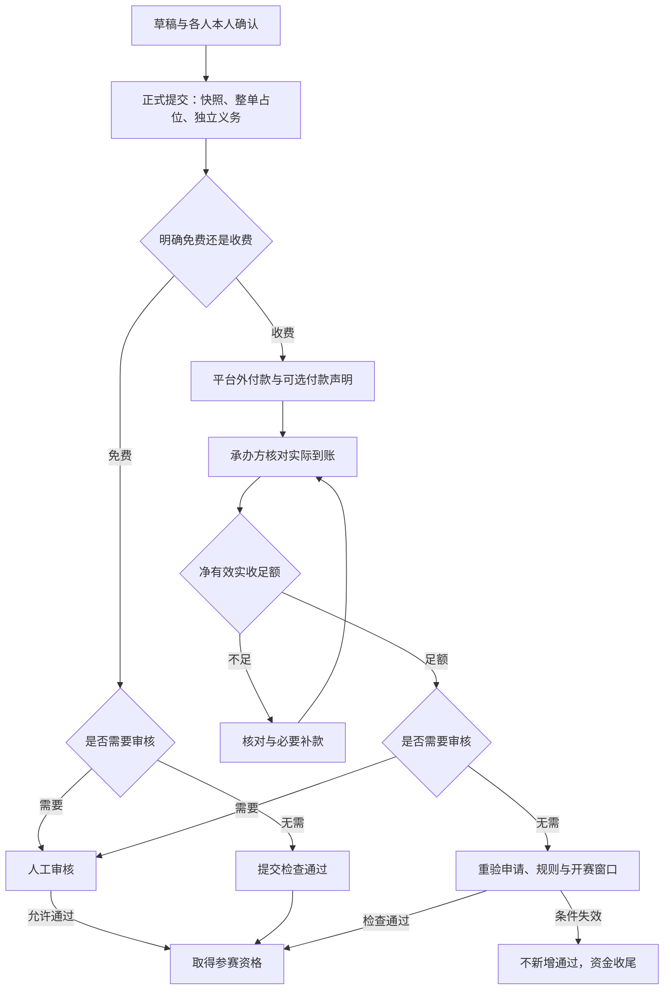

# AISports User Journey

版本：V0.4。日期：2026-10-07。状态：一期目标旅程；不是当前功能演示或已验收流程。

## 1. 阅读约定

依据 [ADR-011](../03-architecture/ADR-011-一期业务收口与交付边界.md)。角色 U 编号见[用户模型](用户模型.md)，页面 C/B/P 编号见 [Page Map](README.md)，S 编号见[页面状态矩阵](页面状态矩阵.md)。旅程覆盖正常办理、等待、失败与交接；没有实测耗时、情绪曲线或访谈数据，不编造这些结果。

页面拆分和入口是设计建议，同一路由可以承载多个任务。每一步反馈应回答“刚完成了什么、还缺什么、谁来处理”；等待承办方的步骤不得伪装成用户可立即解决。

平台入口更新：用户先在 C00 通用首页识别保定城市站，进入 C01 跨运动目录，再进入有开放能力的 C02。当前仅羽毛球可试点办理；场馆/运动生活次级入口进入方向预告并返回，不进入报名/支付或虚构未来服务旅程。既有八条旅程继续描述当前业务，参见[平台级 UI 信息架构](平台级UI信息架构.md)。

## 2. J01：个人发现赛事并取得资格

主角色 U01/U02；审核与资金交接 U06/U07。目标是完成有效整单报名并辨明资格，而不是只看到提交成功。

| 阶段 | 页面/状态 | 行为与反馈 | 阻碍及下一步 |
| --- | --- | --- | --- |
| 发现 | C01/C02；S03 | 看项目、窗口、整单报价、责任组织/联系、退改说明 | 不公开/取消/无有效收费版本/无名额等分别解释；不默认缺价格即免费 |
| 进入账号 | C03/C04；S01 | 无原任务登录到 C00；赛事报名保留赛事/项目。注册标题“注册”，成功回登录；恢复同样保留原目标 | 独立平台手机号 UI；短信/限频/验证码反馈分开，不自动提交报名；登录后按原任务重验可办理性 |
| 准备资料 | C05/C06；S01/S04/S05 | 报名缺必要档案时引导 C05，保存回同一赛事/项目；选填不强制，再本人确认赛事字段 | 草稿不占位不付款；缺项/类型错误/版本变更在对应字段说明 |
| 正式提交 | C06→C07；S05/S06 | 服务端校验后冻结名单、字段含义及费用，竞争一个整单名额，产生本次义务 | 满额或窗口变化返回真实原因；超时先查询本次提交，不能反复创建新单 |
| 免费分支 | C07；S06 | 人工审核显示待承办方审核；无需审核检查通过即取得资格 | 不创建付款任务；审核窗口结束仍待审则明确未取得资格 |
| 收费分支 | C07/C08；S06/S07 | 可立即按冻结指引平台外付款，提交人可声明付款 | 声明不是到账；承办方核对真实收款，少付待补，多付人工处理 |
| 取得资格 | C07；S06 | 人工审核需净有效实收足额再通过；无需审核到账后重验规则/开赛窗口再自动通过 | 收款本身不保证资格；已取消/撤回/开赛不能新增通过；真实资金仍收尾 |
| 参加与回看 | C07/C15/C13；S09 | 授权现场人员报到；本人看已确认赛果，有依据获奖才有私人证明 | 无正式赛果/无获奖证明如实空态，取消保留标识历史 |

四条资格分支均为已确认规则：

| 审核配置 | 费用配置 | 资格成立条件 | 用户等待对象 |
| --- | --- | --- | --- |
| 需要审核（默认） | 明确免费 | 有效提交后人工审核通过 | U06 |
| 需要审核（默认） | 收费 | 本次净有效实收足额后人工审核通过 | 先 U07 核对，再 U06 审核，可同人兼任 |
| 无需审核 | 明确免费 | 正式提交有效性检查通过即成功 | 提交结果 |
| 无需审核 | 收费 | 足额到账后重验有效申请、规则和开赛前窗口，条件允许才自动成功 | U07 核对及服务端重验 |

首次正式提交锁定审核配置。无需审核不取消资料、名额、时间及权限校验。

## 3. J02：受邀成员本人填写确认

主角色 U03，发起者 U02/U04。目标是确认本人参与及本次字段，而非由发起者代填敏感值。

| 阶段 | 页面/状态 | 行为与反馈 | 阻碍及交接 |
| --- | --- | --- | --- |
| 识别邀请 | C09；S05 | 展示赛事、单元、邀请来源和本次成员关系，登录后核验身份 | 无效/过期/已处理/身份不符明确解释，不向不匹配账号泄露成员信息 |
| 本人填写 | C09/C06；S04/S05 | 填本人字段、核对当前资料并确认 | 不复制其他赛事答案；未提交前字段实质变化保留草稿并要求补填/重确认 |
| 等待发起者 | C09/C07；S05 | 显示本人已确认及整单尚未提交/其他成员未完成 | 发起者看完成情况，不能代成员确认；本人确认不代表已占名额 |
| 正式报名后 | C07；S06/S07 | 成员查看授权整单资格、应付与进度 | 只有提交人/当前队长办理声明和整单撤回；成员不默认看完整付款人明细 |
| 赛后/取消 | C15/C13/C14；S09/S10 | 本人查看正式结果、自己的证明与取消通知 | 双打各成员有本人相关结果访问；不以只通知队长代替通知本人 |

## 4. J03：长期队伍与代表队伍报名

主角色 U04，与 U03 协同。目标是维护长期队伍关系并独立完成本次报名。

| 阶段 | 页面/状态 | 行为与反馈 | 阻碍及交接 |
| --- | --- | --- | --- |
| 建队/加入 | C10/C11；S08 | 按现有规则建队、申请/邀请入队，确认当前队员和队长 | 待处理与已生效关系区分；不能把邀请当已入队 |
| 选参赛名单 | C11→C06；S05/S08 | 当前队长代表队伍选择本次单元及成员 | 长期成员不等于本次名单；每位成员完成 J02，人数符合单元规则 |
| 正式办理 | C06/C07/C08；S05–S07 | 整单快照、占位、独立义务及四种分支同 J01 | 名额按整单统计；费用按整单，不按队员个数叠加报价 |
| 关系变化 | C11/C12；S08 | 当前成员与“加入/退出记录”标签分开；退出后从 C10 读本人历史投影，不新增独立历史页 | 历史入口不恢复完整队伍详情权限；退队不等于撤回参赛，不改冻结名单；详细 UI 随 C10/C11 绘制 |
| 合法撤回/重提 | C07→C06；S05/S06/S07 | 原个人提交人或当前代表队伍队长办理合法整单撤回 | 已通过须截止前且无人报到/无场次；不能局部退员，重提重新确认、占位和付款 |

## 5. J04：组织准入、配置赛事及审核收款

主角色 U05，平台 U09，组织 U06/U07。目标是可公开办理、依据明确的赛事，再按真实事实处理报名。

| 阶段 | 页面/状态 | 行为与反馈 | 阻碍及交接 |
| --- | --- | --- | --- |
| 申请办赛 | C16 → B16；S02 | 首页/我的入口到 B 端填写组织申请；可保存缺项草稿，核对后提交冻结本版 | 同一平台账号，不要求参赛档案或已有组织授权；材料上传入口按最新文件边界后置，不增加固定证照清单 |
| 查看准入进度 | B17；S02 | 查看待审、审核理由/结果及只读提交版本；拒绝到 B16 修改重提并生成下一版 | 待审不能编辑，不覆盖历史，不直接操作审批；查询失败/结果未知先核对，不能当成无申请 |
| 平台准入 | P01/P02 → B17；S02 | U09 沿 RuoYi 后台核对版本后批准或拒绝，结果返回本人 B17；批准真实建立组织/租户/授权 | 非逐场审批；准入标签不宣传为主体或官方资质验真 |
| 切换组织 | B17/顶栏→B02/B01；S11 | 选择获授权组织，重载对应菜单、权限、数据和消息 | 无授权组织不出现；旧异步响应不回填新组织页面 |
| 赛事草稿 | B01/B03/B04；S03 | 新建羽毛球赛事，核对时间、组织责任与可公开联系人 | 责任组织固定，发布联系人快照；已有正式报名后只做不改含义的一般更正 |
| 字段配置 | B15→B14；S04 | 维护本组织目录，赛事统一选择四类字段、必填/顺序/说明 | 不逐项目配置；被引用定义不删除；实质变化使相关草稿重确认；首个正式提交锁定 |
| 项目与费用 | B06；S03/S07 | 设置单元人数、整单容量、明确免费或有效收费版本/收款与退改说明 | 二维码收费缺有效收款图不能开放；只支持收款码文件，不提供付款截图/报名材料上传 |
| 预览发布 | B05→C02；S03 | 组织授权预览并确认公开，首次发布开赛前完成 | 缺项按具体原因修复；无需平台逐场审批；发布不代表所有未实现能力已可用 |
| 报名审核 | B07/B08；S05/S06 | 看冻结名单及必要字段、等待时长，收费足额后人工通过或有理由拒绝 | 开赛不新增通过；声明待核对不当作未付款；长期未付按政策人工拒绝，无自动超时拒绝 |
| 实收记录 | B08/B09；S07 | U07 核对真实付款人、金额、时间并登记；不足继续补款 | payment 与 organize 分权；到账后按审核配置分支，不以点击按钮虚构到账 |

项目/费用配置是该单元报名开放的前提，不额外要求所有单元在赛事首次公开前完成。

恢复公开另走 B05：曾真实发布、当前下架/正常、未结束未取消等条件重新校验；进行中可合法恢复，但不重开报名、不改变旧义务。容量调整不得低于实际占用；有正式提交历史的项目不能直接删除。

## 6. J05：整单撤回、重新提交与赛事取消收尾

主角色 U02/U04/U05/U07，通知协同见 J08。目标是终止有效参赛关系时保留真实历史和资金责任。

| 阶段 | 页面/状态 | 行为与反馈 | 阻碍及交接 |
| --- | --- | --- | --- |
| 查看是否可撤回 | C07；S05/S06 | 展示当前整单的合法操作及实际阻碍 | 已通过：截止前、无人报到且无场次关联，正确提交人/当前队长；其他状态由服务端实际规则判定 |
| 确认撤回 | C07；S05/S07 | 说明释放本单名额、保留历史、退款按原依据人工办理 | 不立即写已退款；撤回与资金状态各自更新，旧请求重试不复活报名 |
| 重新提交 | C06→C07；S04–S07 | 用当前资料和字段重新本人确认，提交新版本、竞争名额、开新义务 | 旧款不抵扣新单；旧单退款仍单独处理，不能承诺保留原资格/名额 |
| 组织取消 | B05/B03；S03 | U05 明确确认取消，停止新报名、通过、现场执行和新证明 | 有重大变更需求采用取消另建，不迁移名单付款；取消不能恢复 |
| 双端历史 | C07/B08；S03/S05 | 显示取消、原名单/状态/义务及资金下一步；历史占用保留但名额停用 | 不批量伪造拒绝，不把下架当取消；真实迟到收款仍登记但不恢复资格 |
| 实际退款 | B09/C08；S07 | 平台外核对原付款人并退款，再录实际金额/时间/接收人 | 部分退款仍办理中；无需退款需原政策和原因；实际累计退款不得超过有效实收 |
| 资金纠错 | B09/B10；S07/S09 | 错金额/未实收用冲正和正确事实，必要补款走原单资金区域 | 已退款记录先核对再受控修复；欠款无执行暂停新报到，有报到/场次人工协调，不删除历史 |

## 7. J06：现场执行、正式赛果及私人证明

主角色 U08 与 U02/U03/U04。目标是让实际执行和正式结果可追溯。

| 阶段 | 页面/状态 | 行为与反馈 | 阻碍及交接 |
| --- | --- | --- | --- |
| 核对报到 | B10；S09 | 授权人员按已通过冻结名单办理一赛事一人一次报到 | 非自助；收费不足按执行分支处理，免费/其他足额款不误拦；取消/结束禁止正常新报到 |
| 手工场次 | B11；S09 | 选择合法参赛关系，手工建立场次 | 不自动抽签/排赛；取消/结束不新建场次；并发和重复请求不重复建事实 |
| 草稿录分 | B11；S09 | 草稿与正式结果区分，导入逐项反馈错误 | 草稿不展示给本人赛果；取消不保存或确认新结果 |
| 确认结果 | B11→C15；S09 | 有权限人员确认，本人相关场次可见正式对阵/比分摘要/胜负 | 结束可完成已有场次结果；确认后不普通编辑覆盖，申诉纠错后续另行实施 |
| 有依据授奖 | B12→C13；S09 | 人工关联正式结果或承办方确认排名依据，留操作者/时间 | 不自动排名发奖，不宣称外部官方等级；取消不出新证明 |
| 本人回看 | C15/C13；S09 | 含非获奖者看本人正式赛果；获奖者看本人私人证明 | 无证明不等于无赛果；队长无权看队员私人证明，取消已有历史明确标注 |

## 8. J07：恢复账号、注销受理及身份异常

主角色 U02/U10。目标是恢复合法访问或合规结束账号，不扩大旧身份权限。

| 阶段 | 页面/状态 | 行为与反馈 | 阻碍及交接 |
| --- | --- | --- | --- |
| 密码恢复 | C04→C03；S01 | 绑定手机验证、人机校验、用途独立验证码重置平台账号密码 | 成功撤销平台及关联组织会话，重新登录；不只改遗留组织用户密码 |
| 修改资料 | C05/P05；S01/S12 | 本人更新基础资料，后台经授权看操作者/时间/字段/结果摘要 | 手机只读；旧提交快照不变；不提供全套敏感前后值/回滚 |
| 提出注销 | 平台实际反馈渠道→P06；S12 | 授权人员核验身份，调用同一注销业务 | 自助公开页/接口可暂不开放；反馈渠道实际地址待上线落实，不放假入口 |
| 解决阻碍 | P06→相应 C07/C11/组织职责；S12 | 列明有效报名、未结资金、队长、唯一组织管理人等事项，先依法处理或移交 | 不自动退赛，不新增常规注销审批；不能直接改库绕约束 |
| 完成关闭 | P06；S12 | 关闭账号/会话、解绑手机、结束有效队员和普通组织访问，保留必要历史 | 关闭不等于全删；具体分类清理期限上线前确定 |
| 同号新注册 | C03/C05→P06；S01/S12 | 新独立账号不继承旧身份/角色；同证件已有档案由授权人员核验证据 | 短信、同名/生日/赛事金额不是足够证据；只恢复必要且本人有权的历史 |
| 误关联处理 | P06；S12 | 先限制问题身份访问，再核验证据受控更正，留摘要/人/时间 | 不重开旧账号，不恢复旧组织角色，不删除资金和成绩事实 |

## 9. J08：取消通知送达与本人收尾

主角色 U02/U03/U04/U05，组织授权通知办理人员按实际权限参与。目标是本人收到可行动通知，并诚实区分送达与业务办理。

| 阶段 | 页面/状态 | 行为与反馈 | 阻碍及交接 |
| --- | --- | --- | --- |
| 固定收件关系 | B05/B13；S10 | 取消事务固定当时有效关系账号并去重，含待确认、提交/通过和未结资金关系 | 通知每位相关成员；不能只发队长或现场在线者 |
| 异步投递 | B13；S10 | 事务提交后可靠投递站内信和最小短信，分别显示渠道状态 | 失败不撤销取消；短信只用当前已验证号码，缺条件记原因 |
| 本人查阅 | C14；S10 | 持久未读/已读，看到取消与自己的下一步 | 短信回执不等于已读，已读不等于退款；不要求强制确认 |
| 查看业务 | C14→C07/C08；S03/S07 | 链接校验当前身份/对象授权，查看取消历史和实际资金进度 | 原公开页下架/不可见不能阻断本人合法关联记录；失效权限说明不能越权打开 |
| 失败处理 | B13；S10 | 临时失败有限重试；未知超时先查询/等回执，错误模板/号码等修正后处理 | 不盲目重复发送，不承诺外部绝对一次送达；实际运营责任/渠道上线前落实 |

## 10. 下一轮线框范围

建议首先为 J01/J02/J04/J05 生成 C02、C06、C07/C08、B03、B07/B08/B09 与 B14 的低保真线框，先验证费用/审核、成员确认、取消/撤回这几组容易混淆的状态。再扩展队伍、现场、通知和平台受理。此顺序是设计建议；全部旅程仍在一期范围，未被顺序后置为不交付。

供应商模板、真实渠道、资料保留期限、部署/恢复和责任人按[一期清单](../01-development/一期未完成事项.md)落实；它们不阻止生成线框，正式页面不能用虚构值代替。

## 2026-10-07：J04 原型补齐

J04 原先已定义组织申请和准入，但首版 HTML 的“我要办赛”仅说明弹窗，未交付该界面。本轮补齐 B16/B17 的填写/草稿/提交/进度/拒绝修改重提/历史/通过进入工作台，C16 仅为入口。申请人为平台账号而非未经批准的组织身份。平台超级管理员复用 RuoYi，P01/P02 审核业务能力仍在一期范围，管理员视觉页本轮暂不生成。八条旅程数量不变，不把准入审核升级为正式资质验真。

本轮已核对文档任务与 HTML 覆盖：定义保留不等于原型已画；逐项缺口及共享 B 端布局见 [UI 覆盖与一致性检查](UI覆盖与一致性检查.md)。

本轮登录 / 注册 / 恢复任务连续性见[登录与导航决定](登录与导航设计决定.md)。HTML 为模拟流程，正式 Vue 路由 / 会话 / 验证码及队伍界面仍按清单落实。

## 2026-10-07：正式 C 端旅程呈现

首页/赛事、账号入口、必要档案、报名/详情/付款指引、邀请、队伍/历史、消息和赛果/证明已使用统一正式 C 端布局。现有原任务返回和服务端授权继续沿用；没有新增或删除旅程。见[C端正式界面改版记录](C端正式界面改版记录.md)。本轮检查个人页用隔离样例，不表示真实 J01/J02/J05 等全链路验收；J04 的 B 端正式视觉仍待实施。

## 2026-10-07：正式 B 端页面覆盖

B16/B17、运营概览与赛事工作区的九个任务已接入正式 Vue；此前 HTML 的 B04/B10/B11/B12 缺页按既有接口补入，新资料见[B端正式界面开发记录](B端正式界面开发记录.md)。逻辑编号、八条旅程和状态要求保留，旧 HTML 覆盖统计不混入正式 Vue 证据；后台管理员仍沿原生布局。当前提交版本/字段与资金表单不表示历史对比或分次退款等全部业务能力完成，真实普通角色验收仍待执行。

## 2026-10-08 正式页面走查调整

赛事列表以进入工作区为主要操作；工作区概览编辑基础信息，“报名设置”集中截止时间/审核方式/报名信息，“发布管理”单独办理，顶部常驻参赛者预览。预览共用 C 详情与卡片，可切换电脑/手机详情及首页卡片，内部只读已保存内容，不发布草稿。原 task=fields 深链保留。组织 Logo 留在 B 端，返回运动平台恢复平台会话，准入通过后 C 顶栏直达工作台。

待审核列表默认只看待审核；不足额通过置灰且说明。付款通知可选，不代表实际到账或资格通过；拒绝/撤回/取消后的真实资金按原款收尾。逐笔实收与实际退款更新，受控更正和真实验收独立保留。具体映射见 [交互执行记录](交互修改执行记录-20261008.md)，业务决定见 [ADR-013](../03-architecture/ADR-013-交互走查与资金事实补齐.md)。

## 2026-10-08 邀请与详情走查补充

邀请人输入目标手机号→自动站内信→可选申请短信/复制链接→受邀本人打开限定对象→确认或拒绝。参赛邀请确认后可看本次伙伴，正式提交前提示名单可能调整；长期入队邀请独立确认，不自动报名赛事。详情顶部返回明确上一级，一级页面沿主导航。

收款人员在报名详情登记真实到账→刷新资格和资金→无需审核符合条件显示自动通过，人工审核保持待审。足额后只提供额外真实收款的补记入口，空金额、必填原因和二次核对。同一事实不再登记；此前第二笔是否错误尚待核对，不直接撤销。见[改进记录](邀请与报名详情改进记录-20261008.md)。
