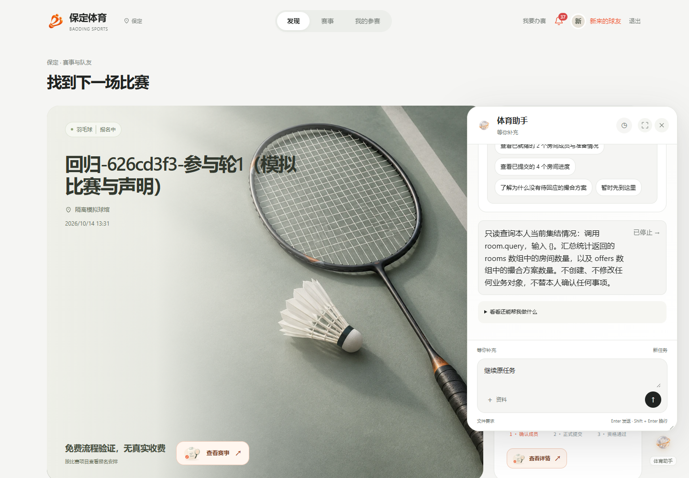
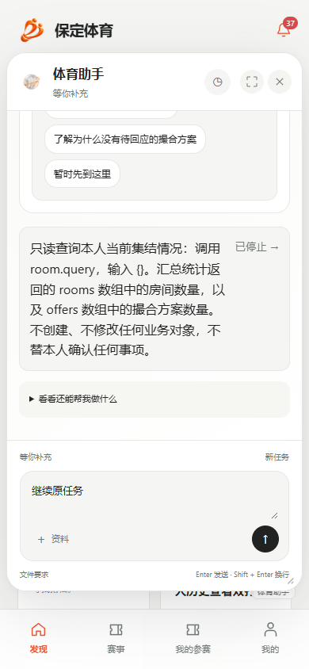

# 通用Agent实际任务界面

2026-10-12。桌面1440×1000和手机390×844，读取最终revision 3普通参赛者真实模型任务；24项浏览器检查通过，无业务写入。父任务实际汇总已查询的房间/方案数，子任务由测试单独停止，截图保留该真实状态。截图已目视检查，输入区和任务区在视口内，没有遮挡或横向溢出。

原始浏览器回执：`.local/product-release-20261011/agent-window-1791761519085/receipt.json`。截图为合成账号和测试赛事，不含真实个人材料。完整范围见[修复报告](../../04-verification/通用Agent修复与能力完善验证-20261012.md)。截图拍摄于停机前；当前项目已恢复打包停机。
