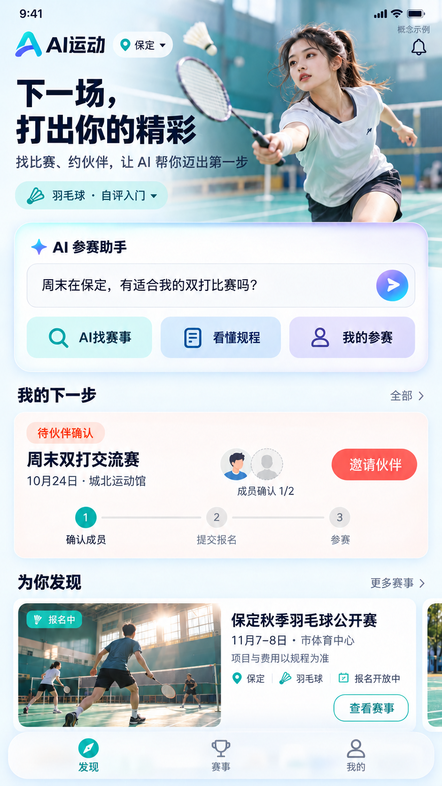

# C 端 AI 原生首页概念图

日期：2026-10-08。性质：视觉探索与信息架构示例，不是已确认的正式设计或已实现功能。使用内置 image_gen（imagegen 技能）生成；没有生成 HTML，没有修改正式 Vue 或业务接口。



## 设计选择

用户提供的第三方小程序截图仅作参赛能力参考，不照搬视觉、规则、支付、积分、广告或品牌。首页为移动端发现页：运动场景与品牌 → AI 参赛助手（找赛事、看规程、我的参赛）→ 本人下一步 → 有推荐理由的赛事卡片。底部保留发现、赛事、我的。

采用冷白、青绿与少量蓝紫 AI 光感，同 B 端共享品牌方向，C 端使用运动画面与个人任务建立吸引力。标题与内容卡保持阅读对比，顶部和底部少量玻璃效果。图片素材均为生成的概念画面，无真实赛事服务承诺。

图中自评入门不是官方竞技等级。双打卡片为待伙伴确认的报名草稿，成员确认 1/2，当前阶段为 1；不使用完成勾选，也不表示正式提交或资格已通过。赛事名称、日期、推荐标签均为演示，费用提示以规程为准，不虚构实际价格或匹配分数。概念图不能代替正式规则验证。

## 后续能力安排

| 能力 | 本轮展示 | 后续出现的位置与条件 |
| --- | --- | --- |
| 运动成长与段位 | 自评标签；隐藏竞技段位、XP、排行榜 | 我的/运动成长；按项目建立真实赛果依据、校准与纠错，区分竞技水平、活跃度及商业权益 |
| 社交 | 已有关系的伙伴邀请任务 | 参赛任务与运动名片；找搭档、陌生人发现、动态、私信需单独治理和运营，不因展示邀请就宣称完整社交已开放 |
| 推荐与信息流 | 赛事卡片和城市、兴趣、报名开放原因 | 发现页逐步扩展；规则推荐先行，内容需真实供给，学习推荐依赖反馈与数据 |
| 出行 | 首页隐藏 | 异地赛事详情/我的参赛中的行程草稿；真实路线、交通与住宿需外部数据和来源时间，无数据不展示报价或预订 |
| 本地生活与商业 | 首页隐藏 | 场地与行程相关服务；真实合作资源、主体及链接就绪后展示，点击不等于预约或成交 |

不在首页铺设未开放功能，后续增强继续保留在原有规划中，不自动纳入一期交付。本轮不改变一期未完成事项或验收状态。

## 视觉核对

已直接查看生成图，核对中文主标题、AI 快捷功能、状态与人数一致性、费用与推荐边界。首版成员进度出现完成勾选且头像数量超出双打人数，进行了单次定点修正：步骤变为 1、未完成连线变灰、头像变为本人和一个待确认占位。最终图已保存到本目录；未执行浏览器或实际业务验收。

## 完整生成提示词

下面保留实际用于内置图片工具的初始提示词及修正提示词，方便后续迭代。

### 初始提示词

```text
Use case: ui-mockup.
Asset type: one carefully designed, premium AI-native Chinese consumer sports app mobile HOME screen for the AISports project. Generate a finished raster UI prototype image, NOT HTML, NOT a wireframe. New design, NOT an edit of attached reference screenshots. Those screenshots only informed the capability list; do NOT copy their visual layout, logos, gold advertising posters or WeChat chrome.

Composition: a single enlarged mobile app screen, portrait roughly 9:19 aspect ratio, entire UI visible with very sharp readable Simplified Chinese text, no physical phone bezel, no perspective, no hands, no floating explanatory annotations. Design at a sensible mobile width equivalent to 430 px; generous but efficient spacing, beautiful polished Figma-like finish. No multi-phone collage. No desktop dashboard. A tiny explicit "概念示例" label at upper right communicates all data is illustrative. Minimal OS status row 9:41 optional. Need to fit all five sections and bottom navigation without cramming.

Product/visual direction: brand "AI运动"; energetic yet calm, appealing to recreational badminton participants. Distinct sports editorial photography, warm human connection, restrained Fluent-inspired translucent surfaces and tactile cards. Shared brand family suitable for an organizer console: cold white/cool ivory foundation, teal/cyan primary, deep navy typography, restrained periwinkle/lilac gradients ONLY for AI accents. A small vivid coral accent may emphasize pending personal action. Refined line icons, same button geometry throughout, 16–20px card radius equivalent, soft shadows and borders, 24px margins, strong typographic hierarchy. Not generic administrator tables. No sci-fi neon, excessive gradients, glowing circuit decoration or gamified fake statistics. Crisp high contrast text and purposeful white space. Glass effect only in the top header and floating navigation with genuinely blurred colored background behind it; content cards predominantly opaque.

Precise screen hierarchy top to bottom:
1. Header: a refined AI lettermark + "AI运动", a small current city pill "保定" with pin and dropdown, right a bell line icon. Small non-primary "概念示例". No user real names.
2. Hero (about 22% screen height) must be genuinely inviting. Large dark navy Chinese title on left in two lines exactly "下一场，\n打出你的精彩". Small supporting copy "找比赛、约伙伴，让 AI 帮你迈出第一步". Right side is beautifully integrated editorial photographic crop of a generic young adult woman badminton player in modern neutral sportswear, focused in a dynamic forward swing, on a sunlit teal court; racket visible, NOT a celebrity. Soft feathered silhouette into the cool white ground, subtle curved court lines leading into the layout. Don't let photo overpower title. This is the central emotional sports image, not an ad poster. Tiny preference pill under title exactly "羽毛球 · 自评入门" -- this is self-assessment, NOT a certified ranking.
3. Main AI command card overlaps the hero slightly or sits immediately underneath, luminous but refined cyan-to-periwinkle 1px edge and white center. Label "✦ AI 参赛助手", short input-like field containing exact placeholder "周末在保定，有适合我的双打比赛吗？", right a small circular gradient arrow-send button. Three clearly button-shaped persistent rounded shortcuts exactly "AI找赛事" / "看懂规程" / "我的参赛". Use clean icons. This should look like a conversational actionable product, not a giant empty chat box.
4. Personal action area: heading "我的下一步", right small "全部". One compact pale coral/cream or white personal registration card with a small badge "待伙伴确认", title "周末双打交流赛", subtitle "10月24日 · 城北运动馆". Show two small abstract avatar circles and clear text "成员确认 1/2"; primary secondary-sized CTA "邀请伙伴". Include a light 3-stage progress strip "确认成员 → 提交报名 → 参赛", first stage highlighted, later grey. Not already registered, not approved, no payment claims. This demonstrates an existing invite relationship, not stranger social networking.
5. Discovery section: heading "为你发现", right "更多赛事". One highly attractive event card: wide short photo crop of a sunlit indoor badminton court with tiny anonymous players, a subtle photo badge "报名中"; title "保定秋季羽毛球公开赛"; concise metadata "11月7–8日 · 市体育中心", another compact line "项目与费用以规程为准". Show short recommendation reason with location/interest icons EXACTLY "保定 · 羽毛球 · 报名开放中". A clear outlined or teal action "查看赛事". No fictitious recommendation score, no advertised discounts, no guaranteed prize or hotel booking. Card must be structured/readable, image never behind text. If space remains, a cropped glimpse of a next event card is acceptable, but prioritize the full first card.
6. Fixed bottom 3-item navigation rail: line icons + labels "发现" / "赛事" / "我的", "发现" selected in teal. A subtly frosted white rail over the page base with a visible blur layer and safe-area inset. AI is emphasized in its main card above; no inactive future navigation tabs.

Future strategy in this image: DO NOT show rank badge, XP bar, ladder leaderboard, feed posts, stranger chat, travel tickets, local restaurants, hotel deals, booking buttons, marketplace or rows of disabled "未开放" modules. The real estate already accommodates future growth via user self-assessment, participant invitation and reasoned event recommendations; full future services remain hidden until available. All texts requested above should be readable and correctly written. Do not repeat text in meaningless tiny columns. No brands other than AI运动, no third-party sports-bureau logo or false accreditation. Finished image must feel like a coherent, desirable consumer product people would want to use, not just a list of capabilities.
```

### 定点修正提示词

```text
Use case: precise-object-edit / ui-mockup. Edit this finished mobile UI concept with two precise business-status corrections ONLY, preserve the entire composition, styling, Chinese copy, photographs, colors, spacing, header, AI card, discovery card and bottom navigation.
In the "我的下一步" card:
1) The first teal step currently contains a white check mark. Replace ONLY that checkmark with white numeral "1". This is the CURRENT pending stage, not a completed stage. Keep label "确认成员" unchanged, keep steps 2 and 3 grey. The connector AFTER step1 must be neutral light grey, not teal filled completion line, as membership is incomplete.
2) The member illustration currently has two avatars PLUS a plus placeholder (three circles). Replace with exactly TWO circles, one normal small self avatar and one pale dotted pending-partner silhouette circle. No third circle and no plus circle. Keep text exactly "成员确认 1/2", pending badge exactly "待伙伴确认", and action exactly "邀请伙伴".
Do not change anything else. Same full-size portrait image, pixel-quality typography preserved. No extra captions or explanatory annotations.
```

