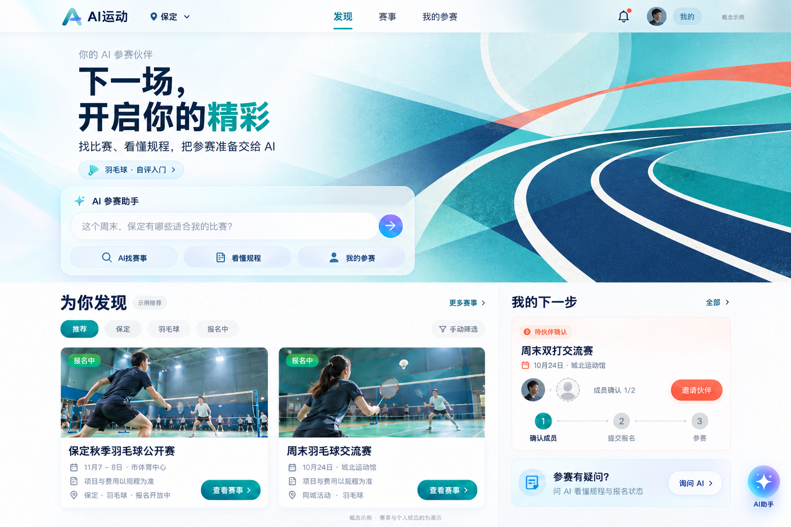
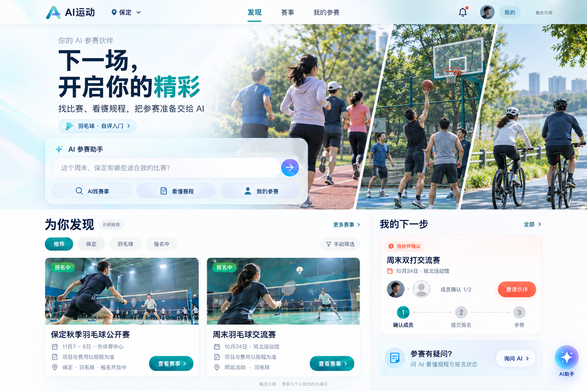
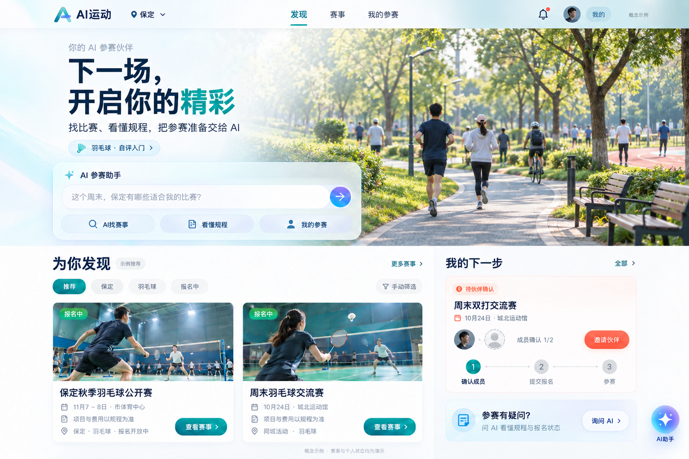
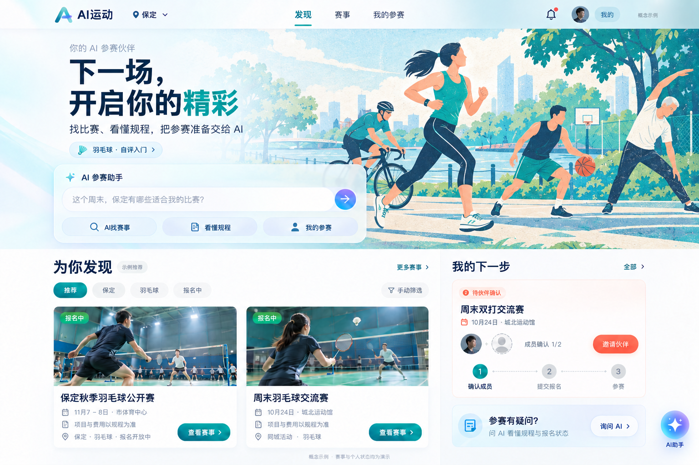

# C 端通用主视觉四方案对照

日期：2026-10-08。状态：用户已暂定 D「平面运动插画」作为 C 端首页主视觉方向；图片仍为概念稿，不代表正式功能、真实赛事照片或业务验收。

## 当前选择

用户决定：「感觉 D 要好一些，可以先定 D」。后续 C 端移动端与桌面端共用 D 的二维多运动插画风格，沿用冷白、青绿、深蓝及少量暖色，保留桌面稿左侧渐隐和 AI 参赛入口。移动端按屏幕比例重排插画构图，避免直接压缩整张桌面图。AI 感由交互入口和界面表达，主视觉保持运动与生活的亲和力。A/B/C 留作备选参考。尚未重新生成移动稿、制作独立插画资产或接入正式页面。

按用户要求生成四版同结构桌面首页，保留冷白与青绿色、左侧渐隐、AI 参赛助手、赛事卡片与个人下一步。首屏标题统一为「下一场，开启你的精彩」，输入示例统一为「这个周末，保定有哪些适合我的比赛？」。首屏表达多运动平台，下方羽毛球赛事仍是当前示例；不会据此宣称其他项目已开放。

| 方案 | 视觉特点 | 适合用途 | 判断 |
| --- | --- | --- | --- |
| A 运动轨迹图形 | 弧线、场地几何与节制的色彩叠加，无具体人物和项目 | 通用默认首页、跨项目品牌系统 | 备选参考；可进一步落成 SVG，移动端易裁切 |
| B 纪实运动拼贴 | 跑步、篮球、骑行分区，表达多项目参与 | 活动运营、真实内容供给充分后 | 目前图片仍为生成示意，定稿应用授权真实摄影 |
| C 城市运动生活 | 日常公共空间与普通参与者，公共服务气质更强 | 城市运动季、地方公共服务推广 | 目前为生成场景，不能当作保定真实场馆；定稿选本地实拍 |
| D 平面运动插画 | 二维人物与多种活动、纸张印刷质感 | 有温度的品牌首页、社区运营 | 用户已暂定为默认方向；后续建立一致的插画资产体系 |

当前采用 D 作为默认方向，取代此前 A 常驻、D 主题的设计建议。B、C 留作摄影运营方向，具备真实素材后使用。四版不需要同时出现在正式首页，也不增加「未开放」入口。未来主视觉配置项另行设计，本轮未实现。

## A · 运动轨迹图形



## B · 纪实运动拼贴



## C · 城市运动生活



## D · 平面运动插画



## 生成与验证记录

使用内置 image_gen，以既有桌面概念图进行编辑，四版保存在 concepts 目录；生成工具原始输出保留。输入参考为「C端桌面首页概念图-20261008-v1.png」。B、C 是摄影构图方向的 AI 生成概念，并非真实摄影；A、D 采用平面视觉方向。

直接查看四张输出，核对通用标题、输入示例、左右渐隐、AI 入口、下方卡片和伙伴确认步骤。未运行正式前端、接口或普通角色业务验收；未修改原始用户截图、正式 Vue、B 端 HTML、数据库及一期未完成事项。

研究依据及案例链接见 [通用主视觉方向调研](C端通用主视觉方向调研-20261008.md)。只借鉴设计方法，不复制第三方品牌标识或作品。

## 完整生成提示词

### A · 运动轨迹品牌图形

```text
Use case: precise-object-edit / ui-mockup.
Edit the provided full desktop web UI screenshot into one comparable hero-visual variant for "AI运动", a public-service AND commercial multi-sport participation platform.
Allowed changes ONLY: (1) replace the large top hero artwork/photo behind the headline and AI card, removing the close-up woman and badminton racket, and (2) change the hero headline from "下一场，打出你的精彩" to EXACTLY "下一场，开启你的精彩", maintaining the same two-line hierarchy, dark navy with teal emphasis, and (3) change the AI input placeholder to EXACTLY "这个周末，保定有哪些适合我的比赛？".
INVARIANTS: preserve every other UI component, the same full landscape screenshot dimensions and layout, A brandmark and navigation, city selector, cold-white/teal brand, left text positions and readability, lovely feathered dissolve from artwork on the RIGHT to cool white on the LEFT, translucent AI command card and its three shortcut buttons, user preference pill (still "羽毛球 · 自评入门"), the entire LOWER half including the two badminton event cards, exact personal task statuses and avatars, step 1 highlighted but not completed, right-bottom AI launcher. Lower cards depict currently available badminton events and must remain as they are. ONLY hero represents a future multi-sport brand, not a claim that extra sports listings are already available.
No annotations, no red boxes, no added variant letters or new headlines, no copy of third-party Olympic/Decathlon logo/assets, no awards/government seals, no brand names in scene. No glow particles, glowing holograms, generative-looking glossy plastic, futuristic circuits, giant floating sports gear or highly polished beauty model. The hero artwork should be visually mature, attractive, approachable, trustworthy and HUMAN-DESIGNED in its art direction. Leftward soft fade is a required original design invariant. HERO A: ORIGINAL FLAT GRAPHIC SPORTS BRAND IDENTITY, no people, no photograph. Create a beautifully composed contemporary screen-printed graphic on the RIGHT: large rhythmic crop of 3–5 clean curved lane lines transitioning through one disciplined circle/arc and a gently sloping diagonal plane, inspired by movement trajectories and sports venue geometry without depicting any single sport. Editorial designer's composition with a confident large negative space, asymmetry, controlled overlapping shapes, quiet soft-cyan field, teal, navy and a tiny restrained warm coral accent. Make the composition actually sophisticated, not vague blobs, generic mesh gradient wallpaper or dozens of literal sport icons. Mostly FLAT 2D colors with just subtle tactile paper grain and a little transparent color overlap; no 3D, glass balls or vapor trails. Think a carefully crafted multi-sport brand poster system, capable of being reproduced in SVG, visibly different from all photographic proposals. Right shape group has purpose and visual balance; left softly disappears into white behind the unchanged hero title and command card. The result is crisp, warm, modern public-sports design, not AI sci-fi styling.
```

### B · 纪实运动摄影拼贴

```text
Use case: precise-object-edit / ui-mockup.
Edit the provided full desktop web UI screenshot into one comparable hero-visual variant for "AI运动", a public-service AND commercial multi-sport participation platform.
Allowed changes ONLY: (1) replace the large top hero artwork/photo behind the headline and AI card, removing the close-up woman and badminton racket, and (2) change the hero headline from "下一场，打出你的精彩" to EXACTLY "下一场，开启你的精彩", maintaining the same two-line hierarchy, dark navy with teal emphasis, and (3) change the AI input placeholder to EXACTLY "这个周末，保定有哪些适合我的比赛？".
INVARIANTS: preserve every other UI component, the same full landscape screenshot dimensions and layout, A brandmark and navigation, city selector, cold-white/teal brand, left text positions and readability, lovely feathered dissolve from artwork on the RIGHT to cool white on the LEFT, translucent AI command card and its three shortcut buttons, user preference pill (still "羽毛球 · 自评入门"), the entire LOWER half including the two badminton event cards, exact personal task statuses and avatars, step 1 highlighted but not completed, right-bottom AI launcher. Lower cards depict currently available badminton events and must remain as they are. ONLY hero represents a future multi-sport brand, not a claim that extra sports listings are already available.
No annotations, no red boxes, no added variant letters or new headlines, no copy of third-party Olympic/Decathlon logo/assets, no awards/government seals, no brand names in scene. No glow particles, glowing holograms, generative-looking glossy plastic, futuristic circuits, giant floating sports gear or highly polished beauty model. The hero artwork should be visually mature, attractive, approachable, trustworthy and HUMAN-DESIGNED in its art direction. Leftward soft fade is a required original design invariant. HERO B: EDITORIAL MULTI-SPORT DOCUMENTARY PHOTO COLLAGE. ONLY in the RIGHT hero zone, use a composed triptych/three cropped image areas assembled by a magazine art director. Three different contexts: a small informal group of ordinary adults jogging on a neighborhood track, recreational mixed-adult basketball in an ordinary outdoor court, and two adults riding everyday bicycles beside a green path. Normal approachable non-model people, actual-looking uneven everyday light, realistic sports clothes, unposed active moments, varied adults, small side/back-view faces rather than hero portraits. No single glamorous athlete. Subtle natural photographic grain, some observational asymmetry, original camera colors gently unified towards teal and blue; NOT cinematic HDR, unrealistically polished facilities, perfect reflections, stylized studio shots or dramatic sunset orange. Distinct photo crops must remain visibly distinct, not merge three sports into an impossible single location. A mature layout with 2–3 planes and discreet overlaps, not a grid of tiny stickers. Light feathering of the group to WHITE at left and original upper-left typography unchanged. This is a CONCEPT of candid real-photography art direction; do not add any caption asserting these are real people, real events or a named city venue. Keep the lower actual UI cards intact.
```

### C · 城市公共运动生活

```text
Use case: precise-object-edit / ui-mockup.
Edit the provided full desktop web UI screenshot into one comparable hero-visual variant for "AI运动", a public-service AND commercial multi-sport participation platform.
Allowed changes ONLY: (1) replace the large top hero artwork/photo behind the headline and AI card, removing the close-up woman and badminton racket, and (2) change the hero headline from "下一场，打出你的精彩" to EXACTLY "下一场，开启你的精彩", maintaining the same two-line hierarchy, dark navy with teal emphasis, and (3) change the AI input placeholder to EXACTLY "这个周末，保定有哪些适合我的比赛？".
INVARIANTS: preserve every other UI component, the same full landscape screenshot dimensions and layout, A brandmark and navigation, city selector, cold-white/teal brand, left text positions and readability, lovely feathered dissolve from artwork on the RIGHT to cool white on the LEFT, translucent AI command card and its three shortcut buttons, user preference pill (still "羽毛球 · 自评入门"), the entire LOWER half including the two badminton event cards, exact personal task statuses and avatars, step 1 highlighted but not completed, right-bottom AI launcher. Lower cards depict currently available badminton events and must remain as they are. ONLY hero represents a future multi-sport brand, not a claim that extra sports listings are already available.
No annotations, no red boxes, no added variant letters or new headlines, no copy of third-party Olympic/Decathlon logo/assets, no awards/government seals, no brand names in scene. No glow particles, glowing holograms, generative-looking glossy plastic, futuristic circuits, giant floating sports gear or highly polished beauty model. The hero artwork should be visually mature, attractive, approachable, trustworthy and HUMAN-DESIGNED in its art direction. Leftward soft fade is a required original design invariant. HERO C: OBSERVATIONAL CITY PUBLIC SPORT LIFE, one WIDE everyday park/community sports-space photograph-inspired scene. Main subject is public space and community participation, not a particular ball sport. A modest neighborhood green public park with a curving pedestrian/jogging path, a few ordinary adults walking or jogging, a cyclist farther away, simple public benches and a glimpse of a modest track or shared activity space. People small, mostly back or side view, spaced naturally; trees have irregular real-life forms, surfaces have ordinary use and slight wear. Pale normal morning daylight, subdued believable natural greens and blue-grey shadows. Camera height around normal standing height, editorial civic-life photo, not drone property rendering, not a luxury futuristic landscaped park, not a resort, not a generic glossy architectural advertisement or perfectly immaculate artificial city. No towering landmarks, no claim of Baoding location, no fake municipal signage, no tourist skyline. Thoughtful composition: path brings eye towards the RIGHT-center; left dissolves gently into the original cool-white UI and teal accents. Welcoming, quiet everyday life, broad appeal, public-service platform. This is a representative visual CONCEPT, not documentary evidence of a real venue. Entire lower UI remains unchanged.
```

### D · 平面运动插画

```text
Use case: precise-object-edit / ui-mockup.
Edit the provided full desktop web UI screenshot into one comparable hero-visual variant for "AI运动", a public-service AND commercial multi-sport participation platform.
Allowed changes ONLY: (1) replace the large top hero artwork/photo behind the headline and AI card, removing the close-up woman and badminton racket, and (2) change the hero headline from "下一场，打出你的精彩" to EXACTLY "下一场，开启你的精彩", maintaining the same two-line hierarchy, dark navy with teal emphasis, and (3) change the AI input placeholder to EXACTLY "这个周末，保定有哪些适合我的比赛？".
INVARIANTS: preserve every other UI component, the same full landscape screenshot dimensions and layout, A brandmark and navigation, city selector, cold-white/teal brand, left text positions and readability, lovely feathered dissolve from artwork on the RIGHT to cool white on the LEFT, translucent AI command card and its three shortcut buttons, user preference pill (still "羽毛球 · 自评入门"), the entire LOWER half including the two badminton event cards, exact personal task statuses and avatars, step 1 highlighted but not completed, right-bottom AI launcher. Lower cards depict currently available badminton events and must remain as they are. ONLY hero represents a future multi-sport brand, not a claim that extra sports listings are already available.
No annotations, no red boxes, no added variant letters or new headlines, no copy of third-party Olympic/Decathlon logo/assets, no awards/government seals, no brand names in scene. No glow particles, glowing holograms, generative-looking glossy plastic, futuristic circuits, giant floating sports gear or highly polished beauty model. The hero artwork should be visually mature, attractive, approachable, trustworthy and HUMAN-DESIGNED in its art direction. Leftward soft fade is a required original design invariant. HERO D: HUMAN-CRAFTED FLAT SCREEN-PRINT / EDITORIAL SPORTS ILLUSTRATION, not photo, no 3D. A restrained original horizontal illustration on the RIGHT combining 3–4 simplified adult figures participating in different activities: jogging, cycling, playing basketball, and a stretching adult. Figures are stylistic FLAT silhouettes with intentional stylized proportions and minimal facial detail, not anatomically photorealistic AI faces. Clearly adult, gender-inclusive, one older adult if artistically sensible. Drawn using consistent charcoal/navy linework and a limited teal, pale-blue, cream and muted coral ink palette; slightly offset print registration and subtle paper texture add crafted editorial quality. Interleave a few park/court geometry cues with mature negative space, not a children's cartoon, generic corporate blob-people, clip-art icon pile, mascot or crowded fantasy panorama. Lively but calm, attractive enough for a public-service + commercial sports platform. Crisp human art-direction, bold deliberate cut-paper or risograph-like shapes, tasteful 2D design. Activity group balances the horizontal field, left gently fades into cold-white preserving the original title and AI command card. Keep all lower UI photos and components untouched.
```
