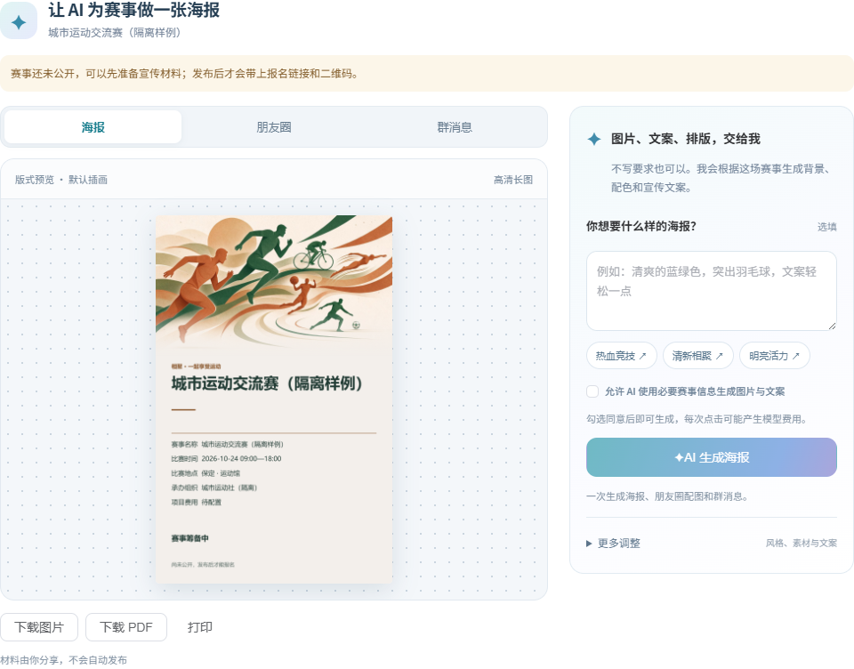
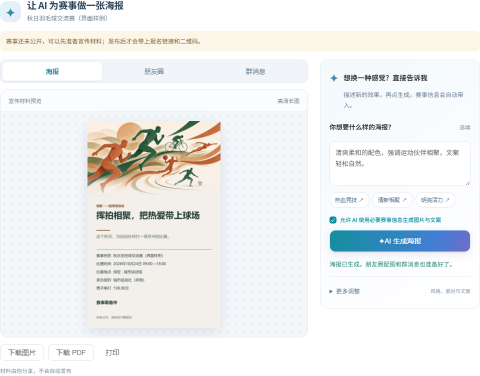
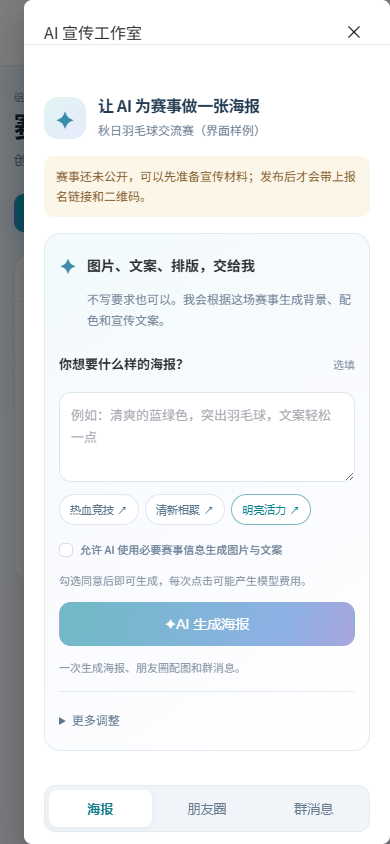

# AI 宣传工作室

日期：2026-10-10。状态：正式Vue界面已实施；截图为合成赛事、隔离接口的实际渲染，不是未接入的概念图，也不证明本轮真实供应商生图。依据[ADR-026](../../../03-architecture/ADR-026-AI宣传工作室与渐进调整.md)。

## 使用路径

赛事管理 → 宣传材料 → 勾选允许AI使用必要赛事信息 → AI生成海报。创作要求可留空；需要调整时描述效果再生成。海报/朋友圈/群消息只显示当前标签，下载或复制跟随选中材料。风格、素材来源及独立文案/图片生成放在更多调整中。

## 设计判断

旧界面要求用户先理解视觉风格、受众、背景来源、是否生图及两个生成动作，再在多种成果中找海报。本轮把目标收敛为一份成果：画布显示赛事事实和当前画面，创作区接收人的意图，一个主动作完成背景、文案和排版。风格灵感是可忽略的快捷描述，不是必须完成的配置步骤。

桌面画布与创作区并排，手机先看到创作入口。初始默认素材标注为版式预览，防止把占位插画误认作AI结果。真实请求阶段代替无依据的百分比，失败说明保留了什么、下一步可以做什么。文案失败可只补文案；无图服务明确退为文案，不给用户一个一定失败的生图按钮。

## 实际界面截图

初次打开，设置默认折叠：

生成完成状态（图片和文案响应均为测试夹具，非真实赛事）：

手机首屏：

## 验证与证据

- PowerShell7运行`./scripts/Test-AiBusinessUi.ps1`，第二轮91项通过，证据`.local/promotion-studio-ui-second.log`与`promotion-studio-ui-20261010/results.json`；首次旧断言错误地期待竞技风格，夹具补足交流赛事事实后应匹配交流风格，已修正，失败日志保留。
- `./scripts/Test-PromotionStudio.ps1`第三轮16项通过，证据`.local/promotion-studio-targeted-third.log`与`promotion-studio-targeted-20261010/results.json`。前两轮是测试选择器错误（Element隐藏原生checkbox、英文关闭名称与中文UI不符），改点真实可见授权标签/关闭按钮后复验，失败日志保留。
- `pnpm run typecheck`退出0；`pnpm run build:dev`成功，51.63秒；证据`.local/promotion-studio-typecheck.log`、`promotion-studio-build.log`。既有大分块提示未新增处理。
- 实际剪贴板复制、导出PNG/PDF及底色/文字区绘图检查通过；桌面与390×844手机截图已查看。未替用户真实赛事保存宣传材料，未发到微信/QQ，未调用真实图像或文案供应商。

普通办赛角色的真实生图→保存文件→读取→取色→文案→下载继续列于一期清单；新的UI通过不关闭这些业务验收。
