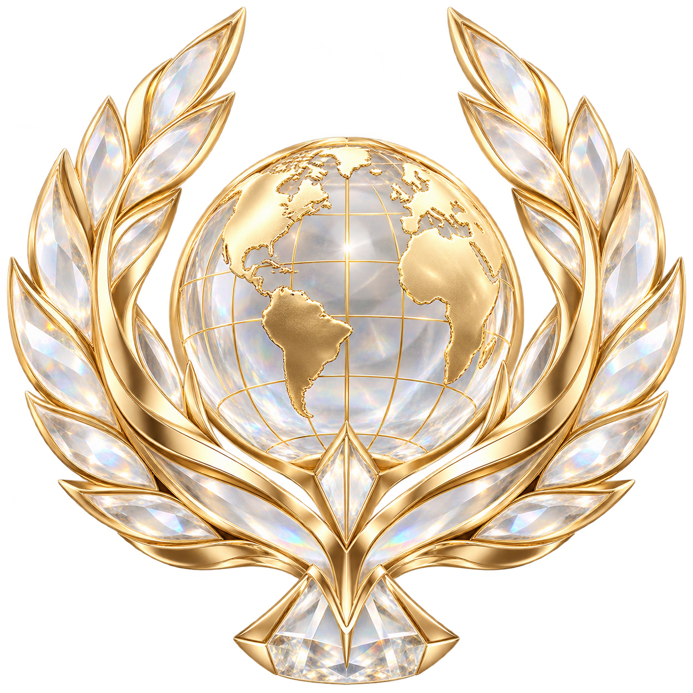
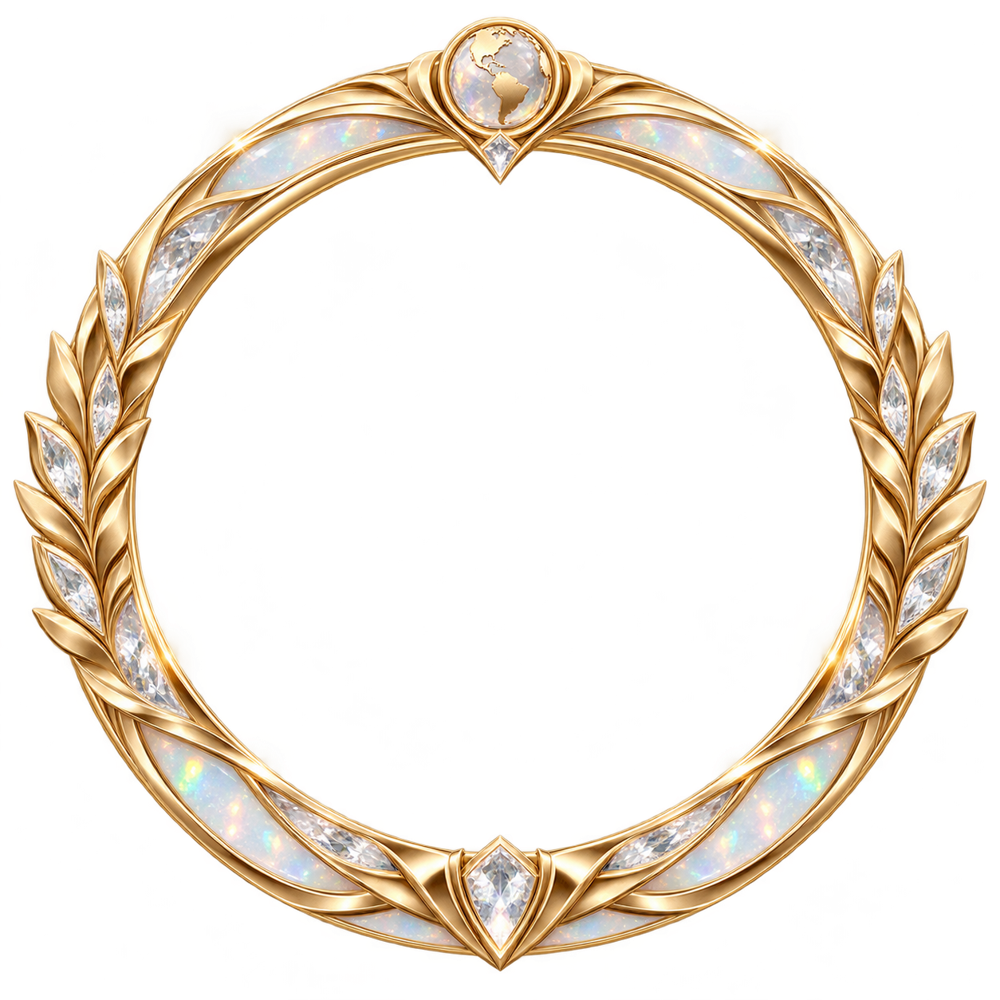
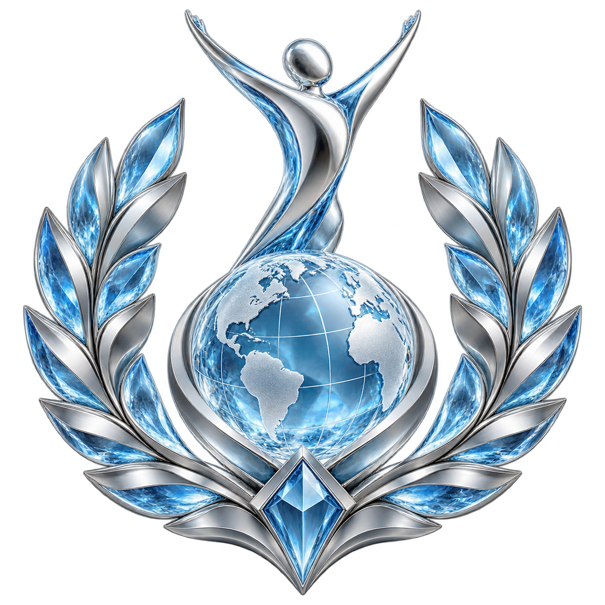
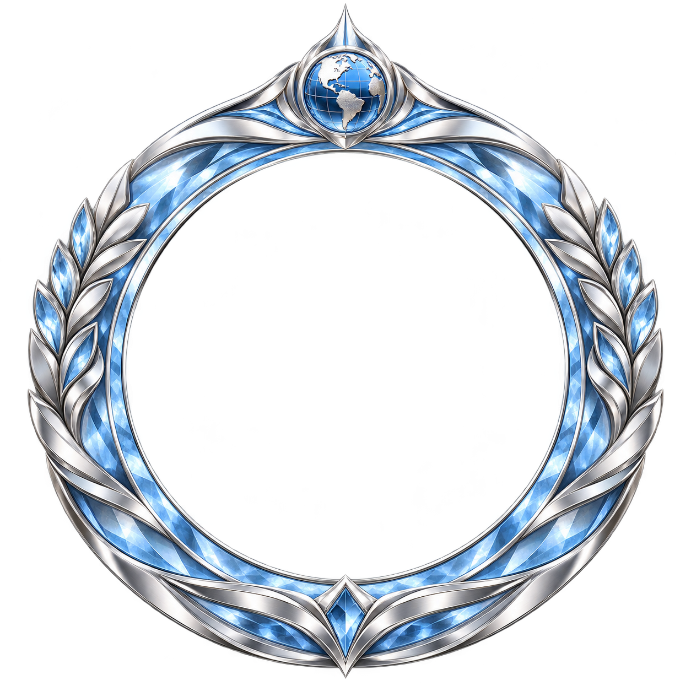
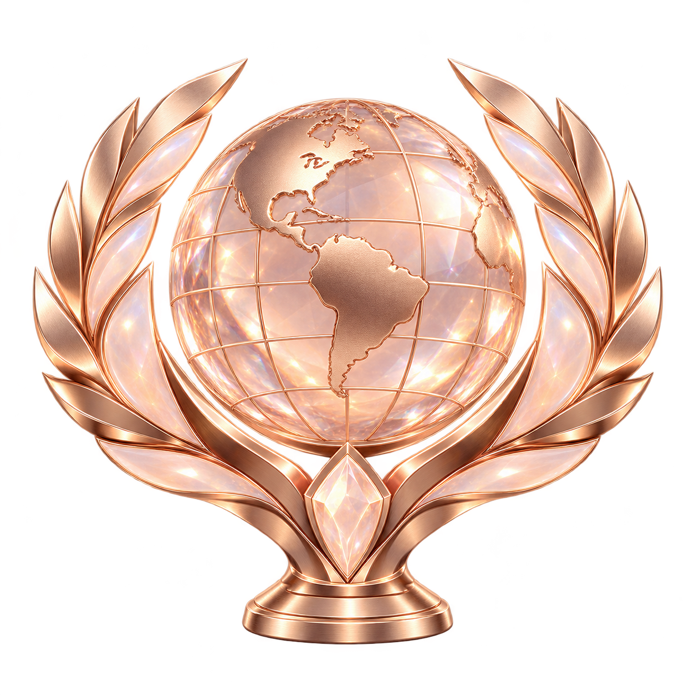
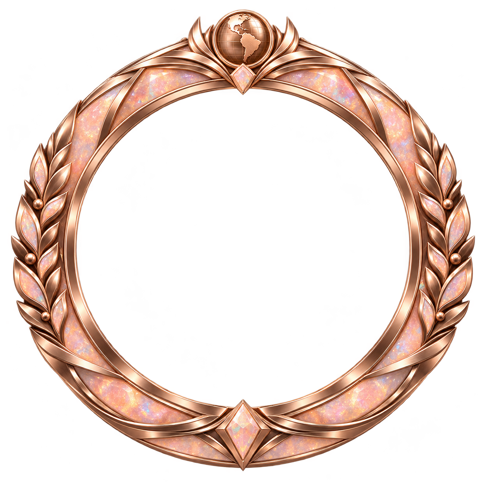
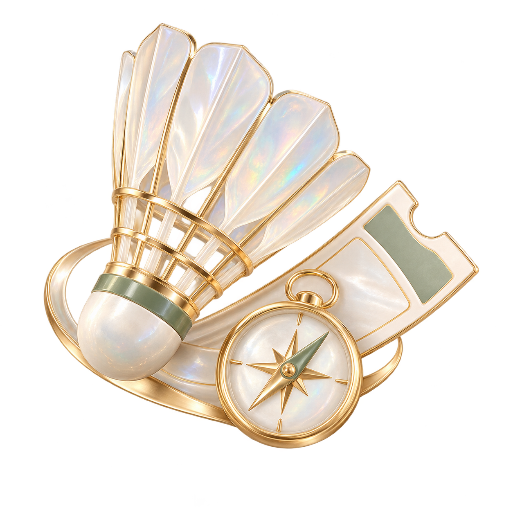
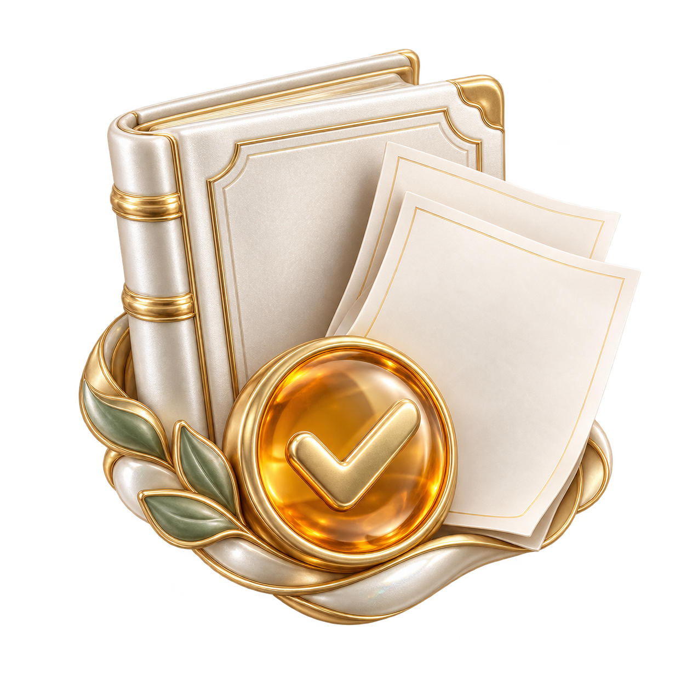

# 世界荣誉与助手静态资源

本轮通过内置 image_gen 生成九项独立透明资源，保留原始PNG、提示词及摘要。徽章和头像框最长边512px，助手卡片图最长边192px；图片只负责外观，不授予认证、积分或权限。生成接口没有返回底层模型标识。

| 荣誉 | 徽章 | 头像框 |
|---|---|---|
| 世界冠军 |  |  |
| 世界亚军 |  |  |
| 世界季军 |  |  |

三张助手功能图分别为比赛、规程、组队：

生产WebP、原图、完整提示词、尺寸、透明度与SHA256见[资源清单](assets.json)。在真实页面的展示约束及合成样例见[世界荣誉展示记录](../world-honor-display-20261011/README.md)，合成图片不代表实际认证成功。
