# 保定体育 · 本轮实际产品截图册

本册收录 2026-10-11 本轮运行中的 **21 张原始页面截图**，供查看正式页面的布局、静态资源与办理交互。页面来自项目实际前端及接口；没有把概念稿数据复制到页面，没有为截图提升段位或发放荣誉。原图已逐字节复制并核对 SHA-256，旧截图和失败记录保留。

**这是实现与验证的留档，尚不代表用户认可整体审美，也不代表真实赛事、资金和现场业务已经完成。** 图片中的参赛者、手机号、队伍、赛事与既有成绩属于隔离演练数据，不能作为官方获奖或真实参赛证明。没有收录密码、令牌和模型凭据。

## 记录来源与范围

| 来源 | 验证回执时间（北京时间） | 环境与本轮验证 | 原始回执 |
| --- | --- | --- | --- |
| 主站首页、登录、快捷助手 | 2026-10-11 10:35:57 | 5190 / 8080，匿名只读；44 项页面、资源及私有入口拒绝检查；未办理登录或业务写入 | [主站回执](evidence-main-readonly.json) |
| 成长、个人资料、房间、长期队伍及段位预览 | 2026-10-11 10:37:33 | 5192 / 8082，隔离普通参赛者；61 项真实读取与外观预览检查；本次未改积分、荣誉、佩戴、报名、资金或比赛事实 | [成长与身份回执](evidence-growth-identity.json) |
| 已保存的实际 DeepSeek 任务对话 | 2026-10-11 10:53:15 | 5192 / 8082，隔离测试账号；26 项实际对话显示与输入交互检查；读取已有任务，本次未再次请求模型或执行业务写入 | [保存对话回执](evidence-agent-saved-task.json) |

三份回执均保留原内容；原检查分别没有失败、页面错误或观察到的业务写请求。主站检查通过不能替代普通角色闭环验收，截图也不能证明动画手感、真实短信、收付款、现场比赛和退款收尾。

来源目录、图片尺寸、字节数、SHA-256 和对应回执详见 [截图来源清单](screenshots.json)。[文件 SHA-256 清单](SHA256SUMS.txt) 覆盖本册所有其他文件，包括 README 与来源清单，不包含清单自身。

## 首页与登录

首页以暖白、石墨和运动橙组织任务入口，羽毛球场景图已实际接入。主站当时没有公开赛事，空状态保留真实数据。登录页呈现手机号与密码操作，并保留返回原任务的提示。

| 桌面 | 手机 |
| --- | --- |
| [首页原图](main-home-desktop.png) 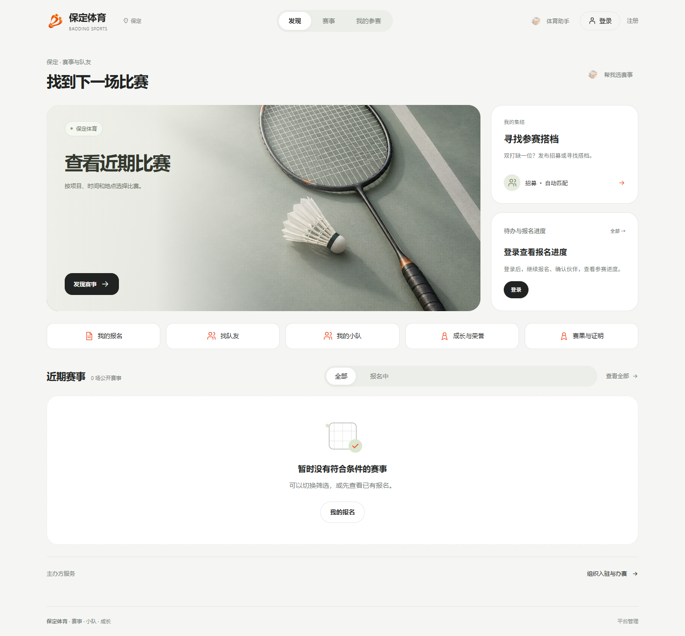 | [首页原图](main-home-mobile.png) 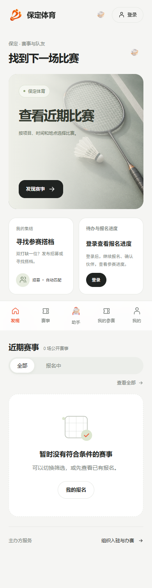 |
| [登录原图](main-login-desktop.png) 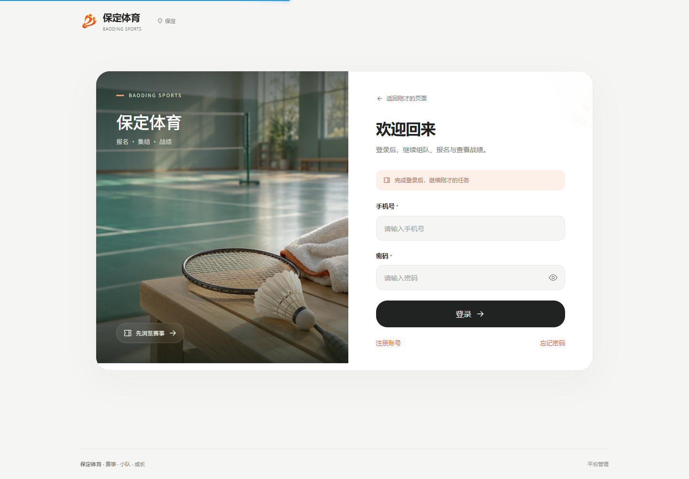 | [登录原图](main-login-mobile.png) 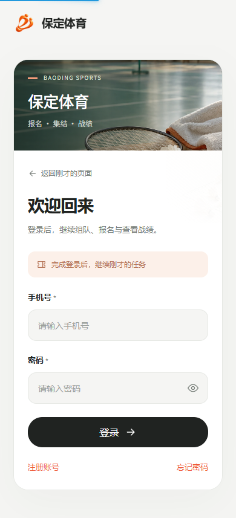 |

## 体育助手

首页快捷入口打开实际助手面板。空对话提供可继续编辑的入口；已保存任务按消息和办理卡片呈现，并将输入区域与对话滚动分开。截图中的“继续原任务”是测试时填写的草稿，没有发送。候选选项只填入消息，实际办理仍遵循后端权限与确认。

| 桌面 | 手机 |
| --- | --- |
| [快捷助手原图](main-assistant-desktop.png) 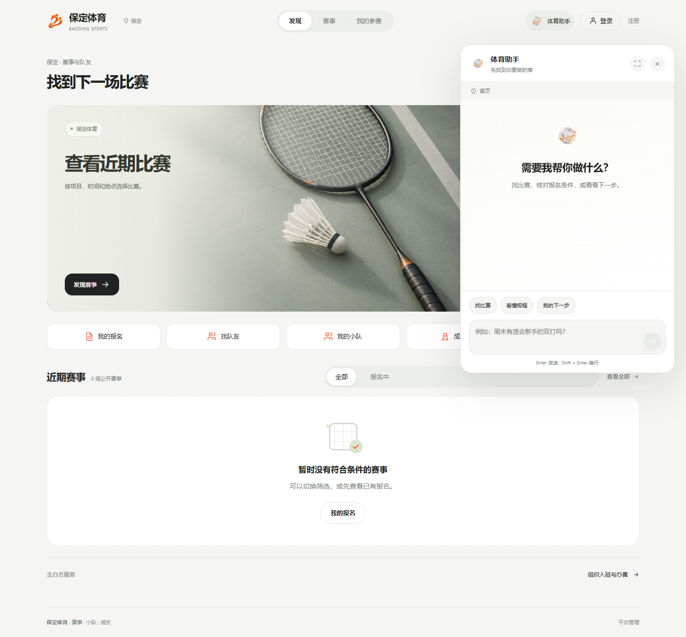 | [快捷助手原图](main-assistant-mobile.png) 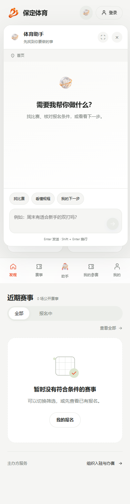 |
| [已保存任务原图](agent-saved-factual-desktop.png) 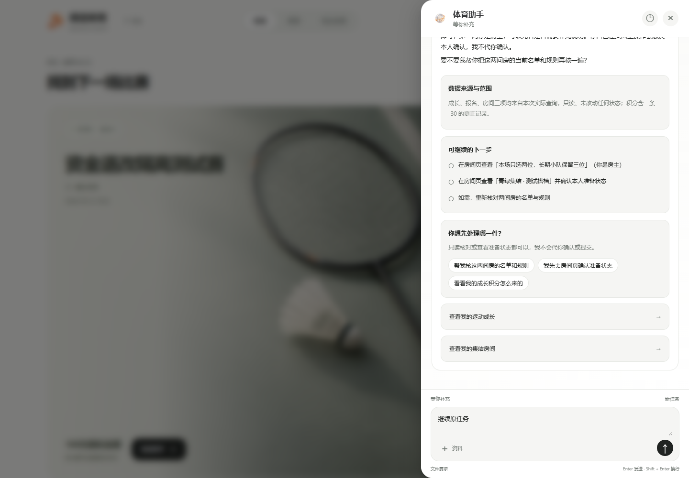 | [已保存任务原图](agent-saved-factual-mobile.png) 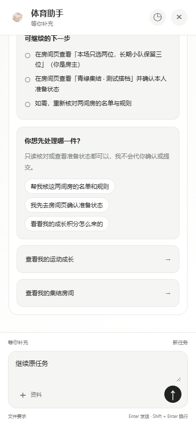 |

## 成长与个人空间

称号展示在头像上方，段位徽章与对应头像框使用独立资源。图中账号在羽毛球项目实际拥有 70 成长分，当前为青铜；名片、称号和成长记录读取隔离环境已有事实，记录中保留了追加的 -30 分更正。昵称、头像、资料与公开范围保持可办理入口，未把段位预览当成已佩戴荣誉。

| 桌面 | 手机 |
| --- | --- |
| [成长原图](growth-records-desktop.png) 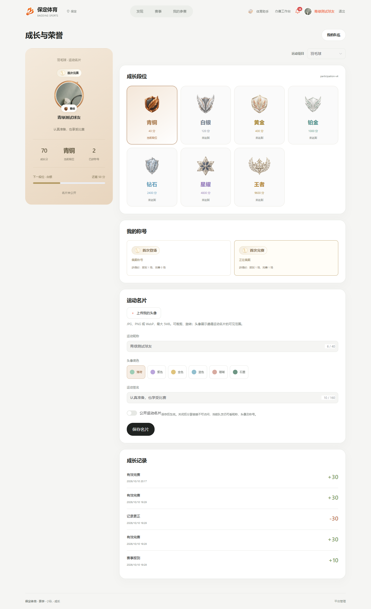 | [成长原图](growth-records-mobile.png) 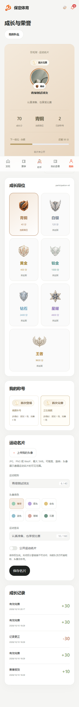 |
| [个人资料原图](personal-profile-desktop.png) 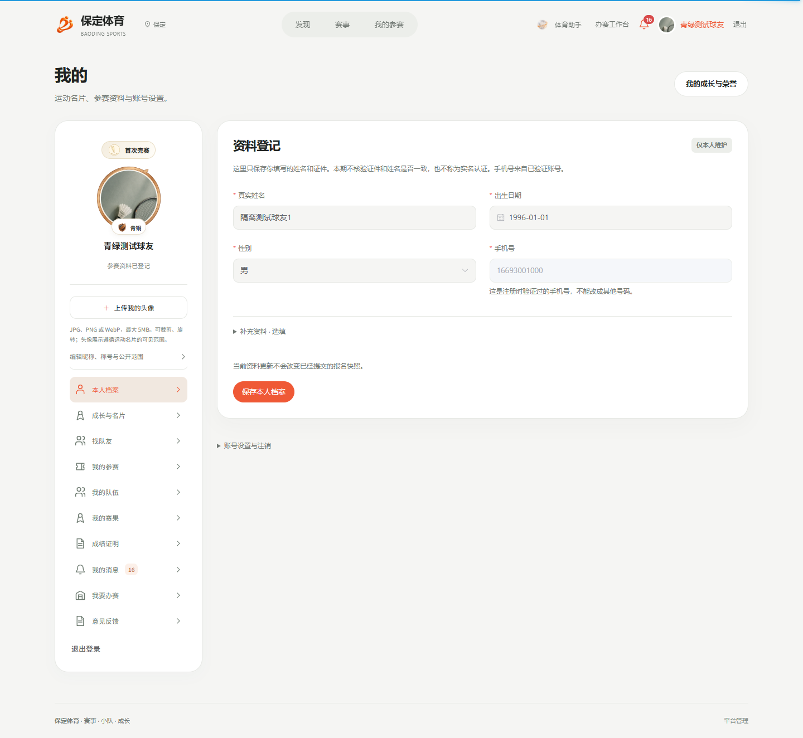 | [个人资料原图](personal-profile-mobile.png) 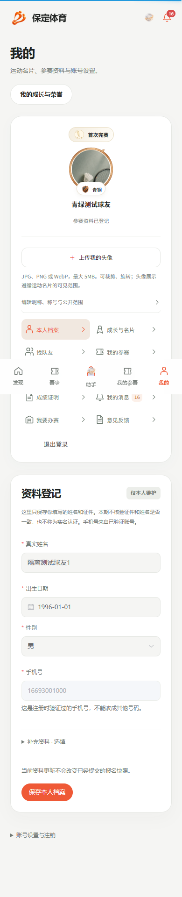 |

## 本场房间与长期队伍

本场双打房间为两人，房主计入一人，成员准备状态独立。截图时两人已准备，尚未提交报名，本轮查看没有改变名单或准备状态。长期队伍显示其实际运动项目下的团队成长和成员段位；未佩戴称号者明确显示未佩戴，没有自动赠送。

本轮已有截图是手机房间与桌面长期队伍，未补造缺少的设备图。移动长页为完整页面截图，固定导航会保留在捕获时的可视窗口位置。

| 手机双打房间 | 桌面长期队伍 |
| --- | --- |
| [房间原图](participant-room-mobile.png) 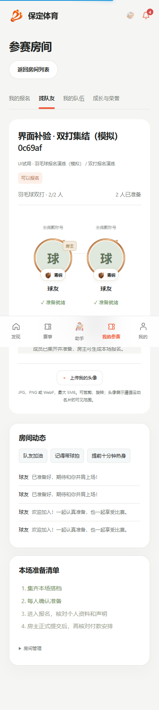 | [队伍原图](longterm-team-desktop.png) 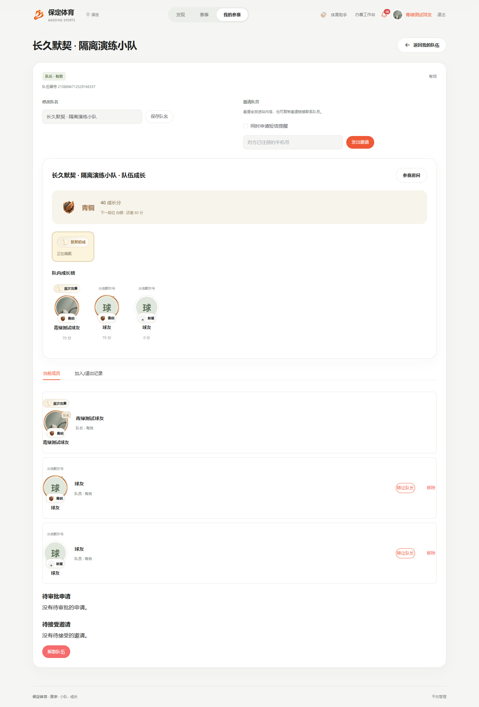 |

## 七档段位与头像框预览

以下是实际成长页的外观预览弹窗，不是为账号发放的新段位。当前规则 `participation-v4` 保留 0 分“新星”基础状态，再设七档运动段位；新用户不会被直接标为青铜。既有历史规则与“荣耀”记录保留，当前活动规则在 4800 分显示星耀，并新增 9600 分王者。门槛属于可版本管理的初始默认规则。

| 青铜 · 40 分 | 白银 · 120 分 | 黄金 · 400 分 |
| --- | --- | --- |
| [原图](rank-bronze-mobile.png) 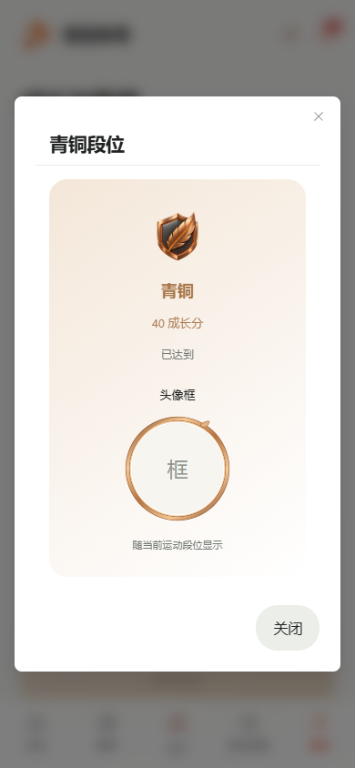 | [原图](rank-silver-mobile.png) 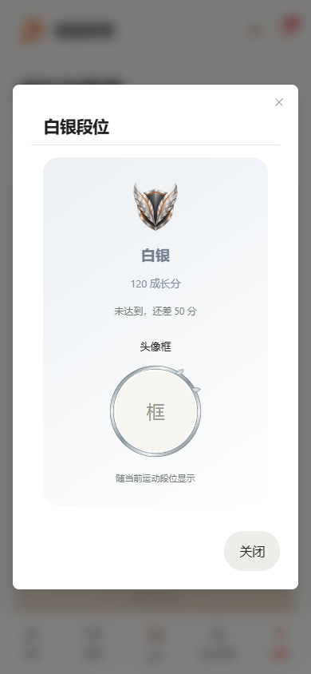 | [原图](rank-gold-mobile.png) 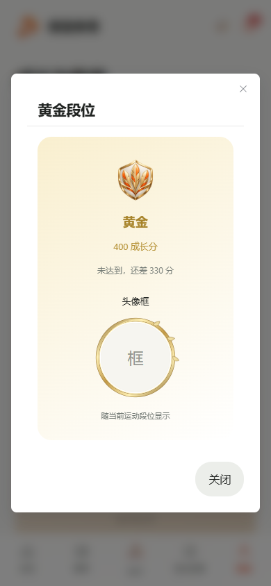 |

| 铂金 · 1000 分 | 钻石 · 2400 分 | 星耀 · 4800 分 |
| --- | --- | --- |
| [原图](rank-platinum-mobile.png) 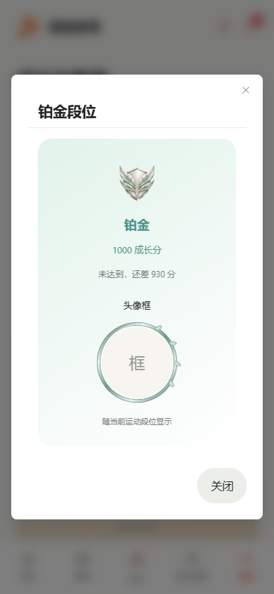 | [原图](rank-diamond-mobile.png) 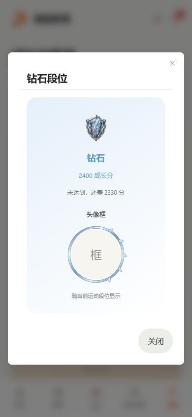 | [原图](rank-stellar-mobile.png) 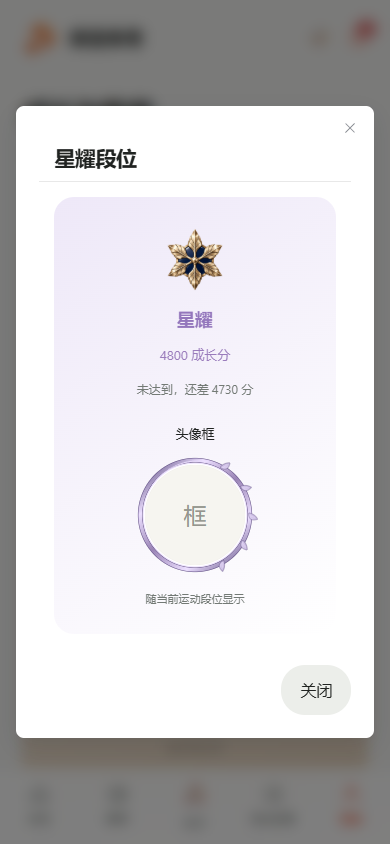 |

| 王者 · 9600 分 |
| --- |
| [原图](rank-king-mobile.png) 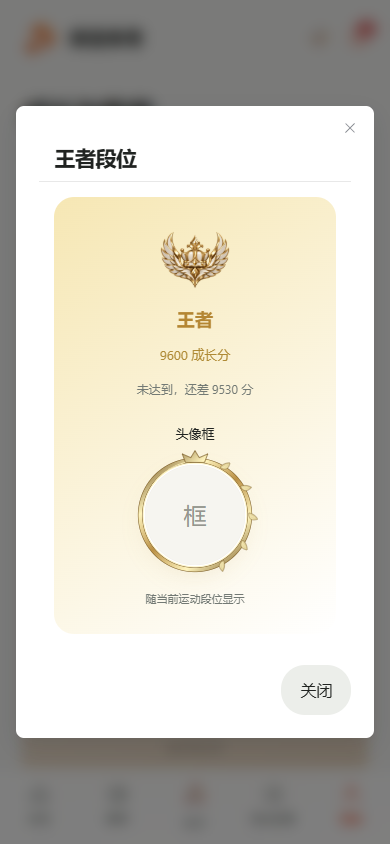 |

徽章使用 `plus-ui/public/images/sports/ranks/*.webp`，头像框使用 `frames/*.svg`，参与称号使用 `titles/*.svg`。它们属于运动成长展示，与正式比赛的金、银、铜名次奖牌分开；没有明确名次的奖项不会推断为冠军、亚军或季军。

## 留档与验收边界

- 21 张图片保持原始像素和文件内容，没有美化、裁剪或重绘。首次复制及清单核验均比较源文件与本册文件的 SHA-256。
- 桌面测试窗口为 1440 × 1000，手机为 390 × 844；完整长页高度随页面内容变化，以来源清单中的实际尺寸为准。
- 本册只整理已经取得的运行证据，没有重放报名、收款、退款、比赛或成长奖励事实。
- 用户对风格、可用性和动效的最终认可仍待亲自测试。完整验收由本轮验证报告单独汇总，不以截图册关闭未完成业务。

