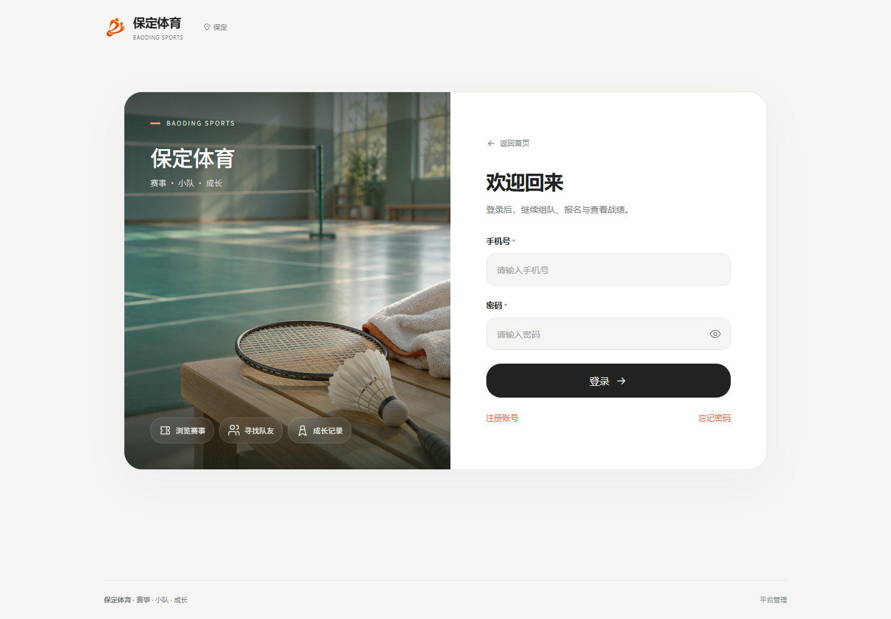
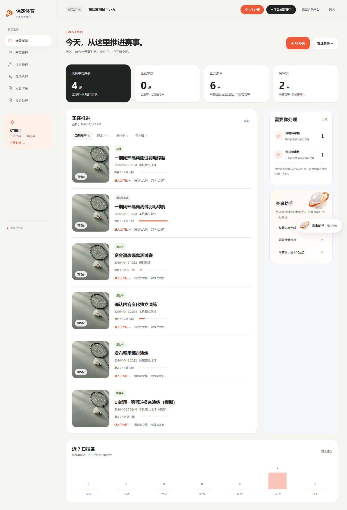
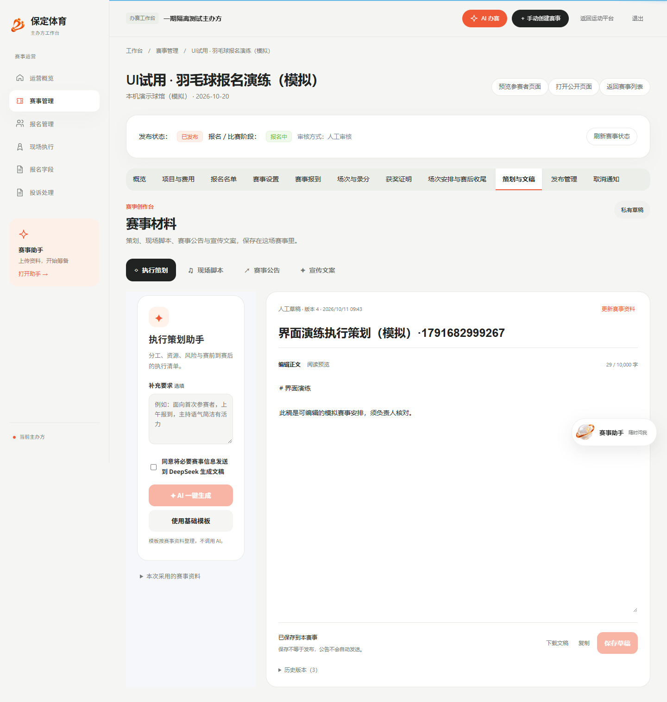

# 正式产品实际截图

2026-10-11。以下图片来自正式 Vue/TS 界面及真实本机隔离服务。账号、组织和赛事为明确标记的演练资料；照片、Logo、助手与成长装饰为本轮生成的产品素材，不冒充现场图片或用户本人。完整验证与边界见 [验证报告](../../04-verification/正式产品界面与创作功能验证-20261011.md)。

| 场景 | 桌面 | 手机 |
| --- | --- | --- |
| 首页 | [打开](desktop-public-home.png) | 正式手机首页在100次逐页证据中 |
| 登录 | [打开](desktop-login.png) | [打开](mobile-login.png) |
| 主办方 | [打开](desktop-organizer-home.png) | [打开](mobile-organizer-home.png) |
| 房间 | [打开](desktop-room-detail.png) | [打开](mobile-room-detail.png) |
| 成长 | [打开](desktop-growth.png) | [打开](mobile-growth.png) |
| 政府 | [打开](desktop-government-home.png) | [打开](mobile-government-organizers.png) |
| 平台对象 | [打开](desktop-platform-objects.png) | 正式手机页面在100次逐页证据中 |
| 策划与文稿 | [打开](desktop-materials.png) | 正式手机文稿页在补充界面证据中 |

原始只读逐页截图与头像、材料、匹配及系统动效录屏保留在受保护 `.local/product-release-20261011` 与 `.local/phase1-implementation/product-release-ui-20261011`。图片不是独立HTML预览的示意数据，页面状态以当前服务为准。
