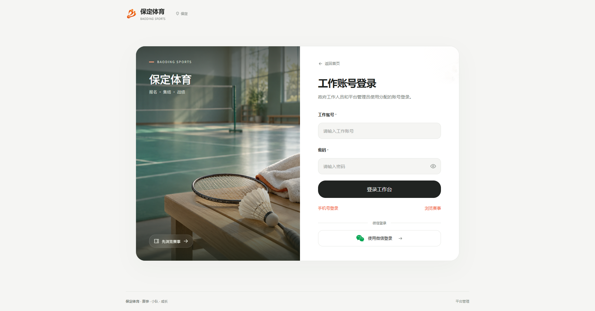
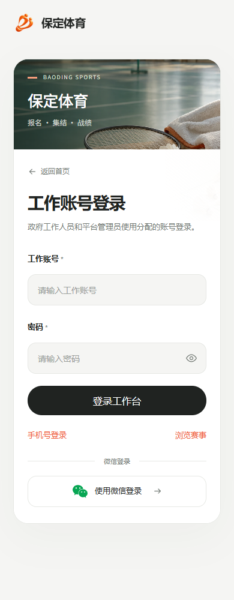

# 工作登录实际截图

主站 <http://127.0.0.1:5190/login> 的实际匿名页面。截图在照片、字体及路由进度结束后保存，未预置账号或Token；390宽为浏览器响应模拟。资源摘要见[screenshots.json](screenshots.json)，实际验证见[本轮报告](../../04-verification/工作账号自动组织与登录布局验证-20261011.md)。

## 桌面，1912像素

## 窄屏，390像素

微信图标可见不表示真实授权接通；当前入口反馈暂不可用并保留填写内容。
